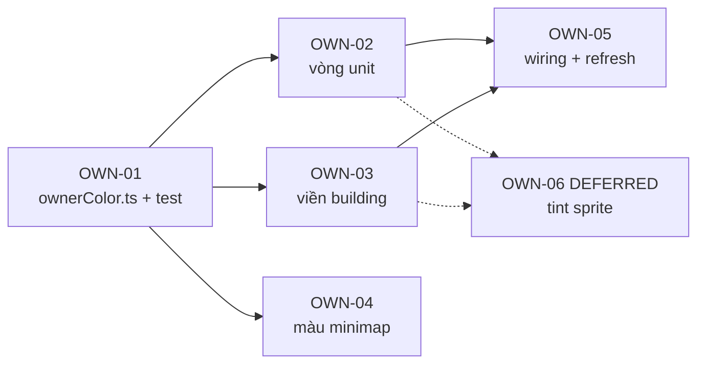

# Phase 01 — Ownership visibility (nhìn ra quân nào của ai)

**Mục tiêu:** trên chiến trường, người chơi phân biệt được **quân/nhà của mình** và **của người
khác** mà không phải hover hay right-click thử.

**Vấn đề:** state hiện được broadcast **nguyên vẹn** cho mọi client — một room `world_room`
(`apps/server/src/index.ts:108`), không fog of war, không interest management. Client render
**mọi** entity nhận được (`apps/client/src/game/scenes/WorldScene.ts:602-604`), nhưng **không có
một dấu hiệu thị giác nào về chủ sở hữu**. Một spearman địch trông y hệt spearman của mình: cùng
sprite, cùng animation, cùng thanh máu.

**Không chạm protocol, không chạm schema** → phase này **không cần reset DB**.

> **Status: `APPROVED`** (chốt 2026-11-01). Bốn quyết định D1–D4 đã được duyệt, `OWN-06` hoãn.
> **Chưa có dòng code nào được viết** — tài liệu này là toàn bộ nội dung của bước plan.

---

## 1. Hiện trạng (đối chiếu code)

| Thứ đã có | Chỗ code | Ghi chú |
| --- | --- | --- |
| Màu người chơi, palette 8 màu | `apps/server/src/rooms/WorldRoom.ts:42-51` | `#3b82f6`, `#ef4444`, `#10b981`, `#f59e0b`, `#8b5cf6`, `#ec4899`, `#06b6d4`, `#84cc16` |
| Gán màu khi tạo empire mới | `WorldRoom.ts:575-576` (`players.size % 8`) | người thứ 1 xanh, thứ 2 đỏ |
| Màu được lưu và restore | `WorldRoom.ts:567` (`savedProfile.color`) | sau lần save đầu tiên thì màu ổn định |
| Client biết owner của chính mình | `WorldScene.ts:153-168` (`myOwnerId`, resolve theo `player.name`) | dùng cho selection / hit-test |
| Minimap phân biệt ta–địch | `components/Minimap.tsx:117-131` | **nhị phân**, không dùng màu thật |

| Thứ còn thiếu | Chỗ code | Hệ quả |
| --- | --- | --- |
| Unit không có dấu hiệu chủ sở hữu | `render/EntityRenderer.ts:238-310` | chỉ có `selectRing` cyan (289-298) hiện **khi được chọn**, và `hpBar` (chỉ hiện khi mất máu, `:434`) |
| Building không có dấu hiệu chủ sở hữu | `EntityRenderer.ts:132-193` | `foundation` (146-161) là indicator **đang chọn**, không phải phe |
| `PlayerState.color` không được render | toàn client chỉ dùng ở `App.tsx:128` (HUD của mình) | màu tồn tại nhưng vô hình trên bản đồ |
| `setTint` gần như không dùng | chỉ `EntityRenderer.ts:203` (farm hết hàng) và `PlacementController.ts:85` (ghost) | — |

Hệ quả gameplay đã thấy: hai đạo quân đụng nhau thì không đọc được ai là ai; địch xuất hiện không
báo trước; chỉ nhận ra khi cursor đổi hình khiêu chiến (`input/CursorController.ts:75`) hoặc lỡ
right-click ra lệnh đánh (`input/CommandController.ts:550-567`).

Ô **edge case quan trọng**: `onLeave` **xoá entry** khỏi `state.players` (`WorldRoom.ts:1039`)
nhưng **giữ** unit/building trong state. Nên tra màu theo `ownerId` **có thể fail** với quân của
người đã offline.

---

## 2. Quyết định thiết kế (đã chốt 2026-11-01)

### D1 — CHỐT: dùng **vòng màu dưới chân** (Graphics), không dùng tint sprite

| Tiêu chí | Vòng màu (`Graphics` ellipse) | Tint sprite (`setTint`) |
| --- | --- | --- |
| Renderer | chạy cả WebGL **và** Canvas | **chỉ WebGL**; `Phaser.AUTO` (`PhaserGame.tsx:51`) rơi về canvas là mất tác dụng |
| Chất art | không đụng pixel sprite | tint là phép nhân → làm bết sprite 8 hướng đã vẽ tay |
| Chi phí asset | 0 | muốn "chuẩn AoE" thì phải bake 4 loại lính × 8 hướng × 8 màu = 256 sheet |
| Đọc ở zoom xa | tốt (khối màu ở chân) | trung bình (bị hoà vào nền đất) |

→ **Chốt D1: vòng màu Graphics.** Tint bị hoãn (`OWN-06`, DEFERRED — xem §9).

### D2 — CHỐT: quân **của mình không có vòng**

Quân mình đã được nhận diện bằng việc chọn được + `selectRing` cyan. Vẽ vòng cho tất cả sẽ tạo
"biển vòng" trên màn hình khi có 3–4 đế chế. Vòng chỉ dành cho entity **không phải của mình**.

### D3 — CHỐT: nhà của mình cũng không có viền màu

Cùng lý do D2. Nhà địch có viền diamond màu chủ sở hữu (đúng footprint) để thấy ngay "nhà này
không phải của mình" khi pan map.

### D4 — CHỐT: màu chủ sở hữu lấy từ `PlayerState.color`, có cache

Tra `state.players.get(ownerId).color` **một lần** (lúc entity được add, và khi `players` thay
đổi) rồi cache theo `ownerId`. Nhờ cache, người chơi offline vẫn giữ đúng màu thay vì nhảy về màu
"không rõ chủ". Không tra trong vòng lặp frame.

---

## 3. Task

Size: **S** < 2h, **M** ~ nửa ngày, **L** ≥ 1 ngày.

| Task | Size | Phụ thuộc | Nội dung |
| --- | --- | --- | --- |
| `OWN-01` | S | — | module resolve màu chủ sở hữu + unit test |
| `OWN-02` | M | OWN-01 | vòng màu dưới chân unit |
| `OWN-03` | S | OWN-01 | viền diamond dưới chân building |
| `OWN-04` | S | OWN-01 | minimap dùng màu thật của từng người chơi |
| `OWN-05` | S | OWN-01..03 | wiring `players.onAdd/onChange/onRemove` + refresh pass |
| `OWN-06` | M | OWN-02 | **DEFERRED** — tint sprite theo màu chủ, chỉ khi WebGL. **Không nằm trong phase này.** |

### OWN-01 — `apps/client/src/game/render/ownerColor.ts` (+ test)

Module thuần, không cần Phaser instance → test bằng vitest như `render/unitMotion.ts`.

```ts
/** Colour for an owner whose player entry was never seen. */
export const UNKNOWN_OWNER_COLOR = 0x94a3b8;

/** '#rrggbb' or '#rgb' -> 0xrrggbb. Returns null for anything else. */
export function parseHexColor(value: string | null | undefined): number | null;

/**
 * Per-owner colour cache. The players map drops an entry when its owner leaves
 * the room while their units stay in the world, so the last known colour is kept
 * instead of falling back to grey mid-session.
 */
export class OwnerColorRegistry {
  constructor(resolveCss: (ownerId: string) => string | null | undefined) {}
  colorOf(ownerId: string): number;   // cache hit -> cached, miss -> resolve, else UNKNOWN
  invalidate(ownerId: string): void;  // colour can change on rejoin (restored from DB)
  invalidateAll(): void;              // called when a new Room is bound
}
```

Edge case phải xử lý:

- hex 6 ký tự, hex 3 ký tự, thiếu `#`, chuỗi rỗng, `undefined`, màu viết hoa → parse đúng hoặc trả `null`.
- `ownerId` rỗng → `UNKNOWN_OWNER_COLOR` (không throw).
- owner **chưa từng** thấy (unit restore từ DB trước khi chủ login) → `UNKNOWN_OWNER_COLOR`.
- owner **đã** thấy rồi offline → giữ màu cũ (cache), không về xám.
- `Room` mới (reconnect/rejoin) → `invalidateAll()` để không dính cache của room cũ.

Test (vitest, `node` env): parse 6/3/invalid; cache sống sau khi owner rời; `invalidate` đổi màu;
hai owner khác nhau ra hai màu khác nhau; `ownerId` rỗng không throw.

### OWN-02 — vòng màu dưới chân unit

Sửa `EntityRenderer.createUnitSprite` (`render/EntityRenderer.ts:238-424`).

- Tạo `ownerRing = scene.add.graphics()`, **add vào container trước `unitDisplay`** để vòng nằm
  **dưới** thân lính; `selectRing` vẫn add sau cùng nên vẫn nằm trên.
- Hình: ellipse **nhô ra ngoài** vòng chọn — `rx = ringRadiusX + 4`, `ry = ringRadiusY + 2`
  (vòng chọn hiện tại: `isCavalry ? 40/20 : 26/13`, `:291-292`), `lineStyle(2, color, 0.85)` +
  `fillStyle(color, 0.18)`.
- `container.setData('ownerRing', ownerRing)`.
- Hàm mới `refreshOwnerRing(container, ownerId)`: đặt visible + vẽ lại màu khi registry đổi;
  gọi lúc tạo và từ `OWN-05`.
- Unit của mình → `setVisible(false)` (D2).
- Không thêm việc gì vào vòng lặp `update()`: vòng là Graphics tĩnh, vẽ một lần.

Nếu đo FPS thấy `Graphics` per-unit quá nặng (xem §7), phương án B: bake **một texture vòng cho mỗi
màu** bằng helper `createCanvasTexture` trong `renderers/ProceduralSprites.ts:456-470`, rồi mỗi
unit chỉ là một `add.image` (rẻ hơn Graphics, và vẫn renderer-agnostic). Làm B ngay từ đầu cũng
chấp nhận được nếu muốn tối ưu trước.

### OWN-03 — viền diamond màu chủ cho building địch

Sửa `EntityRenderer.createBuildingSprite` (`:132-193`).

- Tái dùng đúng hình diamond của `foundation` (`:146-159`) nhưng là Graphics **riêng**
  (`ownerBase`), màu theo chủ sở hữu, `lineStyle(2, color, 0.7)`, fill `alpha 0.12`.
- **Không** dùng chung `foundation`: nó là indicator "đang chọn" của nhà mình và bị
  `SelectionController` bật/tắt (`:124-125`, `:297-298`).
- Building của mình → ẩn (D3). Foundation chưa xây xong của địch **vẫn** có viền (nó cũng là nhà
  của địch), và viền này độc lập với thanh tiến độ xây (`hpBar`).
- Thứ tự add: `ownerBase` trước `img`, để viền không đè lên art toà nhà.

### OWN-04 — minimap dùng màu thật

Sửa `components/Minimap.tsx:117-131`.

- Bỏ cặp nhị phân `isMe ? '#38bdf8' : '#ef4444'` / `'#4ade80' : '#f87171'`.
- Lấy màu qua `sceneRef.current.ownerColorCss(ownerId)` (method mới trên `WorldScene`, wrap
  registry của OWN-01) → minimap khớp với bản đồ chính.
- Quân mình vẫn phải nổi hơn: cùng màu nhưng vẽ 3px, địch 2.5px (đừng đổi sang màu khác, sẽ phá
  tính nhất quán).
- `myOwnerId` vẫn đọc từ `sceneRef.current.myOwnerId` như hiện tại.

### OWN-05 — wiring + refresh pass

Sửa `WorldScene.bindRoomEvents` (`:562-619`).

- Thêm `cb.onAdd('players', ...)`, `cb.onChange(player, ...)` (màu có thể đổi sau rejoin),
  `cb.onRemove('players', ...)` → gọi `entityRenderer.refreshOwnershipVisuals()`.
- `refreshOwnershipVisuals()`: một pass qua `unitSprites` + `buildingSprites`, chỉ vẽ lại vòng/viền
  **khi màu hoặc visibility thực sự đổi** (giữ 1 `Map<entityId, colorNumber>` để so sánh).
  Không gọi mỗi frame; pass chỉ chạy khi `players` phát sinh event.
- `App.tsx:126-139` đã đăng ký `cb.onAdd('players', ...)` cho HUD — thêm listener thứ hai là hợp lệ
  (`Callbacks.get` trả cùng instance, nhiều listener trên một field đều chạy), **không** cần gộp.
- Khi bind room mới: `ownerColorRegistry.invalidateAll()` trước pass refresh.

Lý do cần pass này (không chỉ set lúc tạo entity): lúc server restart, unit được restore từ SQLite
**trước** khi chủ login (`WorldRoom.ts:259-274` chạy trong `initializeWorldPersistence`), nên unit
địch có thể add vào scene khi `players` chưa có entry → lúc đó ra màu xám, và phải tự sửa khi entry
xuất hiện.

### OWN-06 — (DEFERRED) tint sprite

**Hoãn theo D1/D3 đã chốt: phase này chỉ làm OWN-01..OWN-05.** Mục này giữ lại làm đặc tả sẵn
nếu sau khi chơi thật vẫn thấy vòng chưa đủ rõ; mở lại thành phase riêng khi đó.

- Tint bằng `unitDisplay.setTint(color)` **chỉ khi** `scene.game.renderer.type === Phaser.WEBGL`,
  ngược lại fallback về vòng của OWN-02 (tint là no-op trên Canvas, im lặng nên dễ tưởng bug).
- Không tint 100%: dùng `Phaser.Display.Color.Interpolate` để trộn màu chủ ~35% vào tint trắng, nếu
  không sprite sẽ thành khối màu phẳng, mất chi tiết 8 hướng đã dựng công ở `render/unitDirections.ts`.
- Ảnh hưởng: farm đang dùng `setTint` để báo hết hàng (`:203`) → phải kiểm tra hai tint không ghi
  đè nhau (farm là building, khác loại, nhưng nếu sau này tint cả building thì phải cộng màu chứ
  không gán).

---

## 4. Thứ tự & phụ thuộc



**Phạm vi phase này = 5 commit:** `OWN-01` (thuần logic + test), `OWN-02`, `OWN-03`, `OWN-04`, rồi
`OWN-05` sau cùng vì nó chạm cả hai loại sprite. `OWN-06` (nét đứt) hoãn.

Thứ tự commit đã chốt:

1. `feat(client): add owner colour registry for entity ownership`
2. `feat(client): draw owner ring under units of other players`
3. `feat(client): outline enemy buildings with their owner colour`
4. `feat(client): colour minimap blips by owner`
5. `feat(client): refresh owner visuals when players change`

---

## 5. Edge case (kiểm tra khi review)

| # | Tình huống | Kỳ vọng |
| --- | --- | --- |
| 1 | 2 account, join lần lượt | người 1 xanh `#3b82f6`, người 2 đỏ `#ef4444`; quân địch có vòng đỏ, quân mình không vòng |
| 2 | Unit địch add vào scene **trước** khi entry `players` tới (server vừa restart) | vòng xám `UNKNOWN_OWNER_COLOR`, rồi tự đổi sang đúng màu (OWN-05) |
| 3 | Địch đóng tab (offline) | quân vẫn giữ màu đỏ (cache), không nhảy về xám; entry player bị xoá khỏi state |
| 4 | Chủ sở hữu reconnect | màu giữ nguyên (restore từ DB), không nhấp nháy sai màu |
| 5 | Rời room rồi vào lại (room mới) | registry `invalidateAll()`, không dính cache room cũ |
| 6 | Entity bị remove giữa lúc refresh pass | pass bỏ qua entity không còn trong `unitSprites`/`buildingSprites`, không throw |
| 7 | Chọn unit mình → vòng cyan | `selectRing` vẫn **trên** `ownerRing` (thứ tự add trong container) |
| 8 | 3+ người chơi | mỗi người màu riêng theo palette; minimap khớp bản đồ chính |
| 9 | `color` trong state rỗng/không hợp lệ (DB cũ) | fallback `UNKNOWN_OWNER_COLOR`, không crash |
| 10 | Zoom xa nhất (`ZOOM_MIN`) | vòng vẫn thấy được, không thành 1 px |

---

## 6. Verify

Không chạy được bằng typecheck — cần **2 account** (2 profile browser, hoặc 1 thường + 1 ẩn danh)
trên cùng server `:2567`.

**Bắt buộc:**

1. `cd apps/server && ../../node_modules/.bin/tsc --noEmit` sạch.
2. `cd apps/client && ../../node_modules/.bin/tsc --noEmit` sạch.
3. `pnpm --filter @chien-quoc/client test` (có test mới của OWN-01) xanh.
4. `pnpm --filter @chien-quoc/server test` xanh (không sửa server, nhưng chạy để chắc không hồi quy).

**Kịch bản tay (A = chủ, B = địch):**

| Thao tác | Kỳ vọng |
| --- | --- |
| B tạo 3 dân rồi đi bộ sang base A | A thấy 3 lính có vòng đỏ dưới chân |
| A chọn 1 dân của mình | vòng cyan của selection nằm trên, không có vòng chủ sở hữu |
| A pan tới base B | nhà B có viền diamond đỏ, nhà A không viền |
| B đóng tab | lính B còn trên map vẫn vòng đỏ |
| restart server, A login lại, B login lại | lính B đổi từ vòng xám → vòng đỏ sau khi B vào |
| zoom ra `ZOOM_MIN` (phím `-`) | vẫn phân biệt được phe |
| minimap | chấm quân B cùng màu với vòng trên bản đồ chính |

**Tuỳ chọn (nếu có chrome-devtools MCP):** đọc trực tiếp trong console —
`scene.unitSprites.get(id).getData('ownerRing').visible` và giá trị `ownerColorCss(ownerId)`.

---

## 7. Hiệu năng

- Thêm 1 `Graphics` mỗi unit (hiện đã 2: `selectRing`, `hpBar`) và 1 mỗi building.
- **Đo:** `game.loop.actualFps` với ~100 unit trên màn hình, trước và sau; và thời gian của một lần
  `refreshOwnershipVisuals()` (console.time) — pass này chỉ chạy khi `players` phát event.
- Ngưỡng chấp nhận: FPS không giảm quá 3% so với baseline, refresh pass < 5 ms với 100 unit.
- Nếu vượt: chuyển sang phương án B của OWN-02 (texture vòng bake sẵn theo màu) → mỗi unit chỉ
  còn một `Image`.

---

## 8. Rủi ro

| Rủi ro | Giảm thiểu |
| --- | --- |
| "Biển vòng" gây nhiễu khi đông quân | vòng mảnh (2 px), alpha thấp, `fill` 0.18; nếu vẫn nhiễu thì bỏ fill, chỉ giữ stroke |
| Phaser `AUTO` rơi về Canvas → tint mất tác dụng (chỉ ảnh hưởng OWN-06) | OWN-02 dùng Graphics nên không phụ thuộc renderer; OWN-06 phải check `renderer.type` |
| Màu palette gần nhau (`#10b981` vs `#84cc16`, `#ef4444` vs `#ec4899`) | ngoài phạm vi phase này; ghi vào backlog (cần palette tương phản hơn, và cân nhắc hỗ trợ mù màu) |
| Hai người chơi có thể trùng màu: cấp phát là `players.size % 8` (`WorldRoom.ts:575`) | ngoài phạm vi; ghi backlog (cấp phát theo màu chưa dùng, không theo size) |
| Vòng bị vẽ đè lên nhau giữa unit đứng sát nhau | chấp nhận (giống AoE); vòng nhỏ hơn footprint 1 ô |
| Refresh pass chạy nhiều lần liên tiếp khi nhiều player join cùng lúc | so sánh màu trước khi vẽ; pass idempotent, chỉ đổi khi khác |

---

## 9. Ngoài phạm vi (ghi backlog, không làm trong phase)

- **Tint sprite theo màu chủ** (`OWN-06`) — hoãn theo D1; đặc tả giữ ở §3, mở lại thành phase riêng
  nếu chơi thật thấy vòng chưa đủ rõ.
- **Fog of war / tầm nhìn / interest management** — thay đổi kiến trúc mạng (state per-client),
  là quyết định riêng, không phải task UI.
- Chọn / điều khiển quân đồng minh.
- Hiện tên người chơi khi hover entity.
- Sửa `myOwnerId` đang resolve theo `player.name` (`WorldScene.ts:165-167`) — trùng display name là
  lỗi tiềm ẩn, nhưng là bug riêng, không gộp vào phase này.
- Palette màu tương phản hơn + hỗ trợ mù màu.
- Sửa phụ thuộc của tile/sprite vào zoom để tối ưu render ở `ZOOM_MIN`.
- Autosave 30 s ghi lại toàn bộ resource node (đã bàn riêng) — phase khác.

---

## 10. Definition of Done

- [ ] 4 mục bắt buộc ở §6 đều xanh
- [ ] Kịch bản tay §6 chạy đúng, có screenshot làm bằng chứng
- [ ] Không đụng `NetworkMessage`, không đụng `@type()` → **không** cần reset DB
- [ ] Không thêm việc nào vào vòng lặp `update()` của `WorldScene` (không tra màu mỗi frame)
- [ ] Comment trong code mới viết **tiếng Anh**, có tham chiếu mã task (`OWN-01`…)
- [ ] Mỗi task một commit, message tiếng Anh

---

## 11. Quyết định đã chốt (2026-11-01)

Bốn câu hỏi dưới đây **đã được duyệt**, không cần hỏi lại; cột cuối ghi cái gì đã đổi so với
phương án ban đầu (nếu có).

| # | Câu hỏi | Đã chốt | Ghi chú |
| --- | --- | --- | --- |
| 1 | Quân **của mình** có vòng màu không? | **Không** (D2) | tránh nhiễu; quân mình đã có `selectRing` cyan |
| 2 | Nhà **của mình** có viền màu không? | **Không** (D3) | chỉ nhà địch có viền diamond |
| 3 | Có làm `OWN-06` (tint sprite) không? | **Chưa** (D1) | phase này chỉ 5 commit `OWN-01..OWN-05`; `OWN-06` DEFERRED |
| 4 | Người chơi offline giữ màu hay chuyển xám? | **Giữ màu** (D4) | cache `OwnerColorRegistry`; xám chỉ dùng cho owner chưa từng thấy |

---

## 12. Nhật ký

| Ngày | Thay đổi |
| --- | --- |
| 2026-11-01 | Tạo plan: hiện trạng, 4 quyết định đề xuất, `OWN-01..OWN-06`, edge case, verify, rủi ro |
| 2026-11-01 | Chốt D1–D4 theo đúng đề xuất; `OWN-06` chuyển DEFERRED; status `DRAFT` → `APPROVED`. Chưa viết code |
