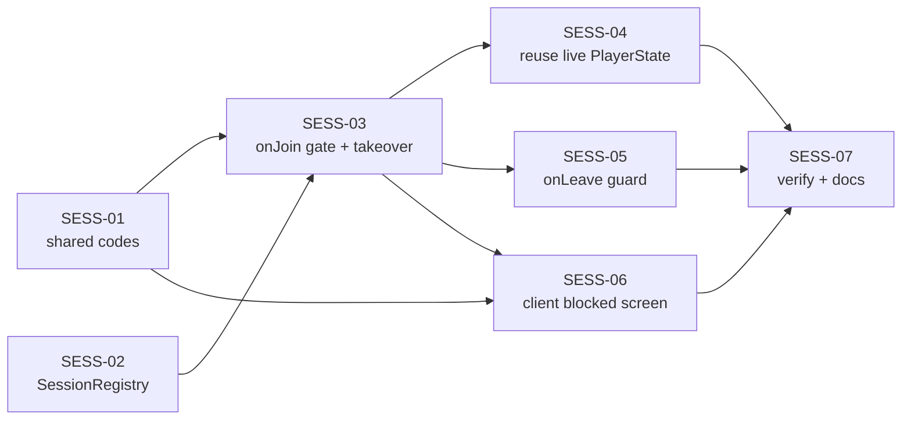

# Phase 02 — Một tài khoản một phiên (chặn trùng phiên)

**Mục tiêu:** một account chỉ có **một phiên điều khiển đế chế** tại một thời điểm. Tab/thiết bị
thứ hai (cùng account) bị **từ chối vào** kèm mã lỗi riêng, và có lối thoát rõ ràng: user chủ động
bấm "Đăng xuất thiết bị khác" để cưỡng chiếm phiên. Không làm lùi tài nguyên, không làm hỏng state
của tab đang chơi, không xoá nhầm empire trong DB.

**Vấn đề:** mục 2 của phân tích "tắt browser / mở tab khác" ngày 2026-11-01. Hiện tại join thứ hai
vào **cùng room** (không bị chặn, không kick ai), `onJoin` **tạo `PlayerState` mới từ DB** đè lên
entry đang sống, và `onLeave` chỉ dựa vào một map bookkeeping để đoán ai được quyền xoá player.

**Không chạm `@type()`** → phase này **không cần reset DB**. Có chạm hợp đồng client↔server ở mức
**join options** (`force`) và **error/close code**; không thêm `NetworkMessage` mới, nên
`WorldScene.ts` không phải sửa (khác quy ước §2 của README vì đây không phải message).

> **Status: `APPROVED`** (chốt 2026-11-01 qua 2 vòng hỏi đáp). Năm quyết định D1–D5 đã được duyệt,
> heartbeat để backlog. **Chưa có dòng code nào được viết** — tài liệu này là toàn bộ nội dung của
> bước plan.

---

## 1. Hiện trạng (đối chiếu code)

| Thứ đã có | Chỗ code | Ghi chú |
| --- | --- | --- |
| Ownership theo account id | `apps/server/src/rooms/identity.ts:24-26` (`ownerIdOf`) | session id **không** phải khoá sở hữu |
| Một entry `players` / account | `WorldRoom.ts:582` (`state.players.set(ownerId, player)`) | key là `userId` |
| Bookkeeping session | `WorldRoom.ts:121-128` (`activeSessionByUser`), set ở `:583` | chỉ dùng trong `onLeave` |
| `onLeave` không xoá empire của socket bị thay thế | `WorldRoom.ts:1031-1036` | đúng cho trường hợp "rời sau khi bị thay thế" |
| Một base / account sau khi refresh | `WorldRoom.ts:559-591`, test `WorldRoom.test.ts:1420-1433` (ACCT) | `ownedBy(ownerId)` chặn spawn trùng |

| Thứ còn thiếu / đang gãy | Chỗ code | Hệ quả |
| --- | --- | --- |
| **Không chặn phiên thứ hai** | `WorldRoom.ts:532-606` (`onJoin`) không kiểm tra session đang sống; `maxClients` mặc định `Infinity` (`@colyseus/core` `Room.mjs:62`) | 2 tab vào cùng room, cùng gửi lệnh cho một đế chế |
| **Join thứ hai đè tài nguyên bằng DB** | `WorldRoom.ts:557` (`loadPlayerProfile`) → `:566-577` gán wood/food/gold/stone → `:582` `players.set` | tài nguyên live tụt về bản autosave 30 s gần nhất (`:194-197`); `MapSchema.set` khác instance phát ra DELETE_AND_ADD (`@colyseus/schema` `MapSchema.set`, `index.mjs:5604-5611`) nên client cũ thấy player remove/add |
| **Tab "session chính" đóng trước** | `WorldRoom.ts:1038-1048` | player bị xoá khỏi `state.players`, empire được save, nhưng tab còn lại vẫn kết nối → HUD đứng, train quân bị bỏ qua im lặng (`CommandSystem.ts:249-251`) |
| **Join lỗi vẫn ở lại room** | `WorldRoom.ts:603-605` catch chỉ `console.error` | client nửa vời: đã join, không có player, lại còn chiếm một session |
| **Race 2 join đồng thời** | toàn bộ `WorldRoom.ts:532-583` có `await` trước khi ghi `activeSessionByUser` | 2 tab mở cùng lúc có thể cùng lọt qua bước kiểm tra |
| **Không có heartbeat** | `@colyseus/ws-transport` `build/index.mjs` không có ping/pong; `Protocol.PING` (`Room.mjs:1432`) chỉ **trả lời** client | socket chết (rút mạng, sleep) không được dọn; server chỉ biết khi WS close event tới |
| **Client bỏ qua close code** | `apps/client/src/App.tsx:141-150` (`joinedRoom.onLeave(() => …)`) | không phân biệt "bị thay thế" với "mất mạng" |

Hệ quả đã thấy (từ phân tích 2026-11-01): mở tab 2 làm tài nguyên tụt, hai tab giành lệnh, và đóng
tab đúng lúc có thể làm tab còn lại rơi vào trạng thái nửa sống nửa chết.

---

## 2. Quyết định thiết kế (đã chốt 2026-11-01)

### D1 — CHỐT: **phiên cũ thắng** (không tự động cướp phiên)

Join mới khi account đang có phiên sống → **bị từ chối**, không kick ai. Lý do:

- Không bao giờ có hai client cùng điều khiển một đế chế ⇒ không cần xử lý "ai thắng lệnh nào".
- Tài nguyên/tài sản của phiên đang chơi không bị đụng tới.
- Người chơi không bị đá bất ngờ khi đang đánh trận chỉ vì một tab khác tự mở (F5, extension, v.v.).

Đánh đổi: nếu phiên cũ là **xác chết** (socket chưa đóng, ví dụ rút mạng/lid sleep) thì join mới bị
khoá. Lối thoát là D2, không phải tự động cướp.

### D2 — CHỐT: **force takeover thủ công** qua nút trong màn chặn

- Client gửi `force: true` trong join options **chỉ khi user bấm** "Đăng xuất thiết bị khác & vào game".
- Server: `force === true` và account đang bị chiếm → **activate session mới trước**, rồi đá session
  cũ bằng close code riêng (`SESSION_REPLACED_CLOSE = 4004`). Tab cũ hiện màn "phiên đã bị thay thế".
- Không có auto-retry sau khi bị đá (sẽ thành ping-pong đá nhau); user phải bấm lại.

### D3 — CHỐT: **không đọc DB đè khi entry `state.players` đang sống**

Nếu `state.players` đã có entry của account (phiên đang chơi, hoặc takeover vừa xảy ra) thì **dùng
lại chính entry đó**: không `loadPlayerProfile`, không gán lại wood/food/gold/stone, không
`players.set` lần nữa. DB chỉ là nguồn khởi tạo **khi chưa có** player entry (join sau khi leave,
restore lúc boot).

### D4 — CHỐT: **không heartbeat trong phase này**

Chưa thêm ping/pong app-level, chưa có TTL "im lặng quá N phút". Dựa vào:
`ws close event` (bình thường) + nút force takeover (khi socket treo). Heartbeat + auto-evict là
task backlog riêng, vì nó thêm `NetworkMessage`, timer cả hai phía và dễ false-positive với tab bị
browser freeze.

### D5 — CHỐT: mã lỗi/close code nằm trong `@chien-quoc/shared`

Một nguồn duy nhất cho server và client, cùng chỗ với các hằng số giao thức khác:

```ts
/** Join rejected: the account already has a live session (D1). */
export const SESSION_ALREADY_ACTIVE = 4009;
/** Join rejected: another join for the same account is still being processed. */
export const SESSION_BUSY = 4011;
/** Server kicked this socket because another session took the account over (D2). */
export const SESSION_REPLACED_CLOSE = 4004;
```

4004/4009/4011 nằm trong khoảng private-use 4000–4999, không trùng `CloseCode` của Colyseus
(`CONSENTED 4000`, `SERVER_SHUTDOWN 4001`, `WITH_ERROR 4002`, `FAILED_TO_RECONNECT 4003`,
`MAY_TRY_RECONNECT 4010`).

`SESSION_BUSY` tách khỏi `SESSION_ALREADY_ACTIVE` chỉ để client phân biệt được "bị chiếm thật" (hiện
màn chặn) với "đang có join khác xử lý" (tự thử lại im lặng, không dọa user).

---

## 3. Task

Size: **S** < 2h, **M** ~ nửa ngày, **L** ≥ 1 ngày.

| Task | Size | Phụ thuộc | Nội dung |
| --- | --- | --- | --- |
| `SESS-01` | S | — | hằng số session trong `@chien-quoc/shared` + helper `classifySessionJoinError` ở client |
| `SESS-02` | S | — | module `SessionRegistry` (thuần logic) + unit test |
| `SESS-03` | M | SESS-01, SESS-02 | `onJoin`: claim session, từ chối join thứ hai, force takeover |
| `SESS-04` | S | SESS-03 | dùng lại `PlayerState` đang sống thay vì đọc DB đè (D3) |
| `SESS-05` | S | SESS-03 | `onLeave`: chỉ session active mới được xoá player + save; chờ leave đang chạy trước khi claim |
| `SESS-06` | M | SESS-01, SESS-03 | client: màn chặn + nút takeover, xử lý close code 4004 |
| `SESS-07` | S | SESS-01..06 | verify tay 2 profile, cập nhật `docs/plans/README.md` |

### SESS-01 — hằng số session (shared + client helper)

`packages/shared/src/constants/index.ts`: thêm `SESSION_ALREADY_ACTIVE = 4009` và
`SESSION_REPLACED_CLOSE = 4004` kèm docstring tiếng Anh (nội dung như D5). Không phải sửa
`packages/shared/src/index.ts`: nó đã `export * from './constants/index.js'` (`:2`).

`apps/client/src/auth/api.ts`: thêm helper cạnh `isAuthRejection` (`:105-111`):

```ts
export type SessionJoinError = 'taken' | 'busy';

/**
 * Why a failed room join was refused by the session gate, if it was.
 *
 * Keyed on the matchmaking code, never the message text: `'taken'` means another
 * tab/device owns the account (show the blocked screen), `'busy'` means a join
 * for the same account is still in flight (retry quietly), `null` means this was
 * a different failure and the caller should keep its existing handling.
 */
export function classifySessionJoinError(err: unknown): SessionJoinError | null;
```

Edge case: `err` không phải object, `code` là string `'4009'` → chỉ nhận đúng **number**
`SESSION_ALREADY_ACTIVE` / `SESSION_BUSY`; mọi giá trị khác trả `null` (giữ nguyên hành vi cũ).

### SESS-02 — `apps/server/src/rooms/Sessions.ts` (+ test)

Module thuần, không phụ thuộc Colyseus → test bằng vitest (đặt cùng thư mục, như
`Pathfinder.test.ts`).

```ts
export type ClaimOutcome = 'claimed' | 'occupied' | 'busy';

/**
 * Which session currently owns each account, and which join (if any) is
 * reserving it right now. One instance per room; all state is in memory, so a
 * room dispose clears it together with the world.
 */
export class SessionRegistry {
  /**
   * Reserves the account for `sessionId`.
   *
   * - `'claimed'` — reservation held; the caller must call `activate()` or `release()`.
   * - `'occupied'` — another session owns the account and `takeover` is false (D1).
   * - `'busy'` — another join for the same account is mid-flight; retry later.
   *
   * `isAlive` lets the caller drop an owner whose socket is already gone (a
   * refresh closes the old socket before the new page joins), so a refresh is
   * never blocked by its own predecessor.
   */
  claim(ownerId: string, sessionId: string, opts: {
    takeover: boolean;
    isAlive: (sessionId: string) => boolean;
  }): ClaimOutcome;

  /** Commits a reservation: `sessionId` becomes the account's live session. */
  activate(ownerId: string, sessionId: string): void;

  /** Rolls a failed join back, or clears the entry when the active session leaves. */
  release(ownerId: string, sessionId: string): void;

  isActive(ownerId: string, sessionId: string): boolean;
  activeSession(ownerId: string): string | undefined;
}
```

Quy tắc phải cài đúng:

- `claim` khi đã có active **và** `isAlive(active) === false` → xoá entry active rồi coi như trống.
- `claim` khi đã có pending của session **khác** → `'busy'` (không đợi, không ghi đè).
- `claim` khi đã có active còn sống và `takeover === true` → cho reserve (pending) — việc takeover
  thật xảy ra ở `activate()` (SESS-03), không phải ở đây.
- `activate` **luôn** ghi đè active cũ (đó là takeover), đồng thời xoá pending.
- `release` chỉ xoá entry khi đang là của đúng `sessionId`; session cũ gọi `release` sau khi đã bị
  thay thế **không** được xoá active của session mới.
- Không throw với `ownerId`/`sessionId` rỗng.

Test (vitest, node env):

| # | Case | Kỳ vọng |
| --- | --- | --- |
| 1 | claim lần đầu | `'claimed'`, `activeSession` vẫn `undefined` (chưa activate) |
| 2 | claim lần hai khi đã activate | `'occupied'` |
| 3 | claim lần hai với `takeover: true` | `'claimed'`; `activate` → active đổi sang session mới |
| 4 | hai claim đồng thời (session khác nhau) | claim 1 `'claimed'`, claim 2 `'busy'` |
| 5 | `release` sau khi join fail | claim lại được |
| 6 | `release` của session đã bị thay thế | active của session mới giữ nguyên |
| 7 | active đã "chết" (`isAlive` false) | claim mới `'claimed'` không cần takeover |
| 8 | `isActive` | đúng cho active, sai cho mọi session khác |

### SESS-03 — `onJoin`: chặn phiên thứ hai + force takeover

Sửa `WorldRoom.ts`:

1. Thay field `activeSessionByUser` (`:121-128`) bằng `private readonly sessions = new SessionRegistry()`
   và `private readonly leaveByUser = new Map<string, Promise<void>>()` (dùng ở SESS-05). Không giữ
   hai nguồn sự thật.

2. Đầu `onJoin` (`:532`), trước khi chạm state: chờ leave đang chạy (nếu có) rồi claim. `claim` là
   bước **đồng bộ** — không có `await` xen giữa `claim` và quyết định, nên hai join không thể cùng
   lọt qua:

```ts
// SESS-05: a refresh closes the old socket before the new page joins, and the
// in-flight leave is what saves the empire. Wait for it so this join never reads
// a half-written account.
await this.leaveByUser.get(ownerId)?.catch(() => undefined);

const takeover = (options as { force?: unknown } | undefined)?.force === true;

// SESS-03/D1: the account keeps its first live session; a second tab is told
// so instead of silently sharing the empire.
const claim = this.sessions.claim(ownerId, client.sessionId, {
  takeover,
  isAlive: (sessionId) => this.clients.get(sessionId) !== undefined
});
if (claim === 'occupied') {
  throw new ServerError(SESSION_ALREADY_ACTIVE, 'Tài khoản đang được đăng nhập ở nơi khác.');
}
if (claim === 'busy') {
  // Distinct code: the client retries quietly instead of showing the blocked screen.
  throw new ServerError(SESSION_BUSY, 'Phiên đăng nhập khác đang được xử lý, vui lòng thử lại.');
}
```

3. **Viết lại khối `try` hiện tại** (`:544-605`):

```ts
try {
  if (this.readyPromise) await this.readyPromise;   // giữ nguyên
  // Giữ nguyên ý nghĩa, nhưng phải là ServerError để mã lỗi tới được client.
  if (this.worldRestoreError) {
    throw new ServerError(ErrorCode.APPLICATION_ERROR, `World restore failed: ${this.worldRestoreError.message}`);
  }
  // ... (DB read + PlayerState + spawn + save, xem SESS-04) ...

  // SESS-03/D2: hand the account to this session first, then close the
  // superseded socket. The old onLeave therefore sees `isActive === false`
  // and never saves its stale snapshot over the live empire.
  const superseded = this.sessions.activeSession(ownerId);
  this.sessions.activate(ownerId, client.sessionId);
  if (superseded && superseded !== client.sessionId) {
    this.clients.get(superseded)?.leave(SESSION_REPLACED_CLOSE, 'Session replaced by a newer login');
  }
} catch (err) {
  // A half-joined client must not hold a reservation, and must not stay in the
  // room as a player-less ghost: release, then let Colyseus tear it down.
  this.sessions.release(ownerId, client.sessionId);
  throw err;
}
```

4. Bỏ `catch` nuốt lỗi hiện tại (`:603-605`) — thay bằng rethrow như trên. Colyseus đã wrap lỗi
   `onJoin` thành lỗi matchmaking cho client (`Room.mjs:1134-1141`), nhưng **chỉ khi không bị catch**;
   catch nuốt lỗi là lý do tồn tại "ghost join".

5. Đảm bảo `throw` rejection xảy ra **trước** khối `try` (nên `claim` đặt trước), để nhánh từ chối
   không đi qua `release` lần nữa và không đụng state.

Edge: `options` có thể `undefined`/không phải object → `force` coi như `false`. `force` do client
gửi lên nhưng chỉ ảnh hưởng chính account đó nên không cần thêm lớp auth.

### SESS-04 — dùng lại `PlayerState` đang sống (D3)

Trong khối `try` của `onJoin`, sau `readyPromise`:

```ts
const live = this.state.players.get(ownerId);

if (live) {
  // D3: a session already owns this account (takeover or a refresh that beat the
  // old socket's close event). In-memory state is newer than the last autosave,
  // so it is the authority; re-reading the DB here rolled resources back.
  live.isOnline = true;
  live.name = playerName;
  this.updatePlayerPopulation(ownerId);
} else {
  // ... nhánh cũ: loadPlayerProfile + tạo PlayerState + players.set + spawn base ...
}
```

Yêu cầu:

- **Không** gọi `loadPlayerProfile` khi `live` tồn tại (bớt 1 round-trip SQLite trong đường takeover).
- **Không** `state.players.set` lại khi `live` tồn tại (tránh DELETE_AND_ADD làm client nháy).
- Nhánh chưa có player: giữ nguyên hành vi cũ, gồm cả `spawnInitialBase` khi không còn building/unit
  (`:585-591`) và `savePlayerEmpire` cho empire mới (`:595-599`).
- `updatePlayerPopulation(ownerId)` vẫn phải chạy cho cả hai nhánh (population/cap có thể lệch so với
  DB sau thời gian chơi).

Test bổ sung trong block ACCT (`WorldRoom.test.ts:1401`):

| # | Case | Kỳ vọng |
| --- | --- | --- |
| 1 | entry live `wood: 999`, DB `wood: 10`, `onJoin` cùng account | `wood === 999`; `loadPlayerProfile` không được gọi; `savePlayerEmpire` không được gọi |
| 2 | entry live + `force` | `state.players.get(ownerId)` **cùng instance** như trước join |
| 3 | không có entry live, DB có row (test ACCT hiện tại) | tài nguyên lấy từ DB — test cũ phải **vẫn xanh** |

### SESS-05 — `onLeave`: chỉ session active mới được rời

Sửa `WorldRoom.ts:1022-1049`:

```ts
async onLeave(client: Client, code?: number) {
  const ownerId = ownerIdOf(client);

  // SESS-05/D1: a rejected join and a superseded socket both leave without
  // owning the account, so neither may delete the player or save the empire.
  if (!this.sessions.isActive(ownerId, client.sessionId)) {
    console.log(`[WorldRoom] Session ${client.sessionId} is not the live session; keeping the empire.`);
    return;
  }

  const leaving = this.saveAndRelease(ownerId, client);
  this.leaveByUser.set(ownerId, leaving);
  try {
    await leaving;
  } finally {
    if (this.leaveByUser.get(ownerId) === leaving) this.leaveByUser.delete(ownerId);
  }
}
```

`saveAndRelease(ownerId, client)` chứa đúng logic cũ: `sessions.release` → lấy `player` → xoá khỏi
`state.players` → `isOnline = false` (giữ nguyên hành vi hiện tại) → `savePlayerEmpire(player, owned)`.

Yêu cầu thêm:

- `onJoin` (SESS-03) phải `await this.leaveByUser.get(ownerId)` **trước** `claim`, để refresh không
  bao giờ claim trong lúc leave cũ đang ghi DB (tránh đọc phải row nửa cũ). Bọc
  `?.catch(() => undefined)`: một leave lỗi không được chặn join mới.
- Log phân biệt 3 ca: `code === SESSION_REPLACED_CLOSE` (bị đá), `code === CloseCode.CONSENTED`
  (user bấm Đăng xuất), còn lại (mất kết nối). Không đổi hành vi, chỉ đổi chất lượng log.
- `onDispose` (`:1051-1054`) giữ nguyên: flush toàn bộ world.

Test bổ sung:

| # | Case | Kỳ vọng |
| --- | --- | --- |
| 1 | session bị từ chối (chưa từng claim) rời room | không `savePlayerEmpire`, player của session sống còn nguyên |
| 2 | session cũ bị kick sau takeover rời | không save, player còn nguyên (đã có test ACCT `:1461-1474`, giữ xanh) |
| 3 | session active rời | `savePlayerEmpire` đúng 1 lần, player bị xoá (test ACCT `:1476-1492`, giữ xanh) |
| 4 | join mới tới trong lúc leave đang chạy | join chờ xong rồi mới claim; không có 2 entry player |

### SESS-06 — client: màn chặn + force takeover

Sửa `apps/client/src/App.tsx`:

1. `connectToWorld(displayName, opts: { force?: boolean; attempt?: number } = {})` (`:98`):
   `client.joinOrCreate('world_room', { force: opts.force === true })` (`:112`).
2. `catch` (`:151-161`): thêm nhánh **trước** `isAuthRejection`:

```ts
const retry = opts.attempt ?? 0;

const sessionError = classifySessionJoinError(err);
if (sessionError === 'taken') {
  setSessionTaken(true);   // state mới, mặc định false
  return;
}
if (sessionError === 'busy' && retry < 3) {
  // Another join for this account is still in flight; retry quietly instead of
  // showing the blocked screen for a conflict that lasts milliseconds.
  await new Promise((resolve) => setTimeout(resolve, 500));
  return connectToWorld(displayName, { ...opts, attempt: retry + 1 });
}
```

   Không xoá token, không hiện toast lỗi chung, không auto-retry; hết 3 lần `busy` thì rơi xuống
   nhánh lỗi kết nối cũ (`:157-161`).
3. `joinedRoom.onLeave((code) => …)` (`:141-150`): nhận `code`; nếu `code === SESSION_REPLACED_CLOSE`
   → `setSessionTaken(true)` + toast "Phiên đã được đăng nhập ở thiết bị khác." và **return** trước
   nhánh "Mất kết nối với máy chủ."; nhánh `isLeavingRef` (Đăng xuất) giữ nguyên.
4. Component mới `apps/client/src/components/SessionBlocked.tsx` (presentational, giống style
   `AuthScreen`): tiêu đề "Tài khoản đang được đăng nhập ở nơi khác", hai nút:
   - **"Đăng xuất thiết bị khác & vào game"** → `onTakeover`: `setSessionTaken(false)` rồi
     `connectToWorld(playerName, { force: true })`.
   - **"Đăng nhập tài khoản khác"** → `onUseAnotherAccount`: `clearStoredToken()`, `setAuthUser(null)`,
     `setSessionTaken(false)` (rơi về `AuthScreen`).
5. Render: `AuthScreen` chỉ hiện khi `!sessionTaken` (`:320-322`); thêm overlay `SessionBlocked` khi
   `sessionTaken && !isJoined`.
6. Sau khi force join thành công: `setSessionTaken(false)` trong nhánh thành công (`:114-117`).

Không đụng `WorldScene.setRoom` (`:472-500`): close code không tạo `Room` mới, không đi qua nhánh
reconnect.

### SESS-07 — verify + docs

- Chạy toàn bộ §6; ghi screenshot màn chặn + màn "phiên bị thay thế".
- Cập nhật `docs/plans/README.md`: thêm dòng phase 02 vào bảng, ghi chú trạng thái.

---

## 4. Thứ tự & phụ thuộc



**Phạm vi phase này = 7 commit**, theo thứ tự:

1. `feat(shared): add session conflict codes and join rejection helper`
2. `feat(server): add per-account session registry`
3. `feat(server): reject a second session unless it takes over`
4. `feat(server): reuse live player state when a session takes over`
5. `fix(server): only the active session may save an empire on leave`
6. `feat(client): block a second session and offer a takeover`
7. `docs(plans): document the single-session phase`

Commit 3 là commit lớn nhất; nếu review thấy quá rộng thì tách "gate + từ chối" (3a) và "force
takeover + kick" (3b), nhưng **không** tách SESS-04 ra khỏi SESS-03 (takeover mà đọc DB đè thì vẫn
là bug tài nguyên lùi).

---

## 5. Edge case (kiểm tra khi review)

| # | Tình huống | Kỳ vọng |
| --- | --- | --- |
| 1 | Tab A đang chơi, tab B join | B bị từ chối (`SESSION_ALREADY_ACTIVE`), thấy màn chặn; A không nhận gì, không giật, tài nguyên không đổi |
| 2 | B bấm "Đăng xuất thiết bị khác" | A bị đóng với code 4004 → hiện "phiên bị thay thế"; B vào game với **đúng** tài nguyên A đang có, không lùi 30 s |
| 3 | B join đúng lúc A vừa F5 (socket A đã chết, `onLeave` chưa xong) | B không bị chặn oan: `claim` thấy A không còn trong `this.clients` → dọn entry; nếu leave của A còn đang chạy thì B chờ xong (SESS-05) |
| 4 | A mất mạng, server chưa nhận close; B join | B bị chặn (đúng D1); B bấm force thì chiếm được |
| 5 | B force xong, A online lại và F5 | A bị từ chối, thấy màn chặn; không tự đá ngược |
| 6 | Hai tab join cùng lúc (double click/paste URL) | đúng 1 cái `'claimed'`, cái còn lại `'busy'` → client tự retry sau 500 ms (tối đa 3 lần), không tạo 2 player |
| 7 | Join bị từ chối rồi Colyseus gọi `onLeave(WITH_ERROR)` cho client đó | `onLeave` return sớm: không save, không xoá player của A |
| 8 | Tab A đang train quân/hái tài nguyên thì bị kick | state không bị rollback; lệnh cũ vẫn tiếp tục ở server; B thấy đúng tiến độ |
| 9 | `force: true` nhưng account đang trống | claim thường, không kick ai, cờ force vô hại |
| 10 | Client gửi `force: 'yes'` / object lạ | chỉ `=== true` mới tính force; còn lại là join thường |
| 11 | Sau khi B force, A bấm "Đăng nhập lại" trong màn bị thay thế | A bị từ chối (B đang giữ), A phải bấm force nếu muốn lấy lại — không ping-pong |
| 12 | Refresh nhiều lần liên tiếp | mỗi lần vào đúng 1 player, không rò rỉ entry trong `sessions` |
| 13 | 2 account khác nhau | độc lập hoàn toàn, không account này chặn account kia |
| 14 | Session active rời, rồi join lại ngay | player được tạo lại từ DB (đúng D3: entry đã bị xoá khi leave), base không bị spawn trùng |

---

## 6. Verify

**Bắt buộc:**

1. `cd apps/server && ../../node_modules/.bin/tsc --noEmit` sạch.
2. `cd apps/client && ../../node_modules/.bin/tsc --noEmit` sạch.
3. `pnpm --filter @chien-quoc/server test` xanh (SESS-02, SESS-04, SESS-05, ACCT cũ).
4. `pnpm --filter @chien-quoc/client test` xanh.
5. `pnpm --filter @chien-quoc/shared run build` (đổi constants) trước khi typecheck client.

**Kịch bản tay (2 profile browser: thường + ẩn danh, cùng account):**

| Thao tác | Kỳ vọng |
| --- | --- |
| A login, chơi 10–15 s cho tài nguyên tăng | ghi lại số wood/food đang có |
| B login cùng account | B thấy màn chặn; A không có toast/lag; log server `not the live session` **không** xuất hiện (B chưa bao giờ join) |
| B bấm "Đăng xuất thiết bị khác & vào game" | A nhận close code 4004 → màn "phiên bị thay thế"; B vào game với **đúng** số tài nguyên đã ghi, không lùi |
| Trong lúc B đang chơi, mở tab C | C bị chặn; B không bị ảnh hưởng |
| F5 tab B | vào lại bình thường, không bị chặn, không mất tài nguyên |
| Mở devtools → Network → Offline ở tab B, rồi mở tab D | D bị chặn; D bấm force → chiếm được; B khi online lại bị đá |
| Đóng tab đang chơi rồi mở lại | vào đúng empire, 1 player entry |
| Kiểm tra DB `apps/server/database/dev.db` sau các bước trên | `Player`/`Building`/`Unit` không có dòng nào bị xoá oan; wood/food khớp trạng thái cuối |

**Kiểm tra thêm bằng log server:** mỗi lần bị từ chối phải có đúng 1 dòng log lý do; mỗi lần
takeover phải có log "session … superseded by …" kèm sessionId cũ/mới.

---

## 7. Hiệu năng

- Đường join/leave chỉ chạy một lần mỗi kết nối; `SessionRegistry` là 2 `Map` theo account → không
  ảnh hưởng tick loop.
- `claim` là O(1) và là bước **đồng bộ** ngay sau khi chờ leave, nên không thêm round-trip trong tick.
- Gỡ được 1 lần gọi SQLite (`loadPlayerProfile`) trong đường takeover (SESS-04).
- Không thêm field schema, không thêm dữ liệu mỗi patch.

Ngưỡng: thời gian `onJoin` không tăng quá 5 ms so với hiện tại (đo bằng timestamp log, 10 lần join).

---

## 8. Rủi ro

| Rủi ro | Giảm thiểu |
| --- | --- |
| Kick sai thứ tự: đá session cũ **trước** khi `activate` → `onLeave` của nó thấy mình vẫn active, xoá player và save đè | Quy tắc bắt buộc trong SESS-03: `activate()` rồi mới `leave()`; có test riêng cho thứ tự này |
| `MapSchema.set` lại cùng key làm client nháy player | SESS-04: không set lại khi entry đã tồn tại |
| Colyseus không giữ nguyên mã lỗi tuỳ biến khi `onJoin` throw | `Room.mjs:1134-1141` giữ `e.code` nếu là `ServerError`; verify tay ở §6 (B phải nhận đúng 4009, không phải 526) |
| Mã 4004/4009/4011 trùng close code của framework | Bảng `CloseCode` của Colyseus đã kiểm (`4000/4001/4002/4003/4010`); ghi comment cạnh hằng số |
| Phiên cũ "xác chết" (rút mạng/sleep) khoá user | D2 force takeover + D4 ghi backlog heartbeat; log để debug |
| Refresh bị chặn oan vì socket cũ chưa đóng | SESS-02 `isAlive` + SESS-05 chờ leave đang chạy |
| Client tưởng nhầm lỗi mạng là "đã có phiên" | Chỉ so đúng code 4009; mọi lỗi khác giữ nhánh cũ |
| `options.force` bị lạm dụng | Chỉ ảnh hưởng account của chính caller (đã xác thực bằng token ở `onAuth`); không cho force account khác |
| Takeover bỏ qua save của tab cũ → tiến độ mới nhất chỉ nằm trong RAM tới lần autosave 30 s | chấp nhận (đúng như lúc đang chơi); nếu cần chắc chắn thì gọi `savePlayerEmpire` một lần ngay sau `activate()` trong SESS-03 |
| Xoá `activeSessionByUser` làm sót chỗ dùng | Grep `activeSessionByUser` trước khi xoá; chỉ có 3 chỗ (`:128, :583, :1031`) |

---

## 9. Ngoài phạm vi (ghi backlog, không làm trong phase)

- **Heartbeat app-level** + auto-evict session chết (D4) — cần `NetworkMessage` mới và timer hai phía.
- **`allowReconnection` / giữ session qua F5** — refresh hiện đã hoạt động nhờ ACCT; làm mượt hơn là
  phase riêng vì phải viết lại `onLeave` + seat reservation.
- **REST/API cho app khác** (mobile, bot): hiện chỉ có `/auth/*`, `/health` và WS Colyseus; không
  thêm endpoint gameplay trong phase này.
- **Offline progress** (dân làm tiếp khi không ai online) — phase khác, phụ thuộc `autoDispose` và
  persist order state.
- **Admin kick / xem session đang online** — ngoài phạm vi.
- Giới hạn số thiết bị/IP, chống chia sẻ account.
- Sửa `onJoin` cho các lỗi không liên quan session (ví dụ lỗi restore world đang bị nuốt) — đã gộp
  phần rethrow tối thiểu vào SESS-03, phần còn lại để phase khác.

---

## 10. Definition of Done

- [ ] 5 mục bắt buộc ở §6 đều xanh
- [ ] Kịch bản tay §6 chạy đúng, có screenshot (màn chặn, màn "phiên bị thay thế")
- [ ] Không đổi `@type()` → **không** cần reset DB
- [ ] Không thêm `NetworkMessage`; nếu có phát sinh thì phải sửa đủ 3 nơi theo README §2
- [ ] Mọi nhánh từ chối/kick đều có log nêu sessionId cũ/mới
- [ ] Test ACCT hiện có (`WorldRoom.test.ts:1401-1510`) vẫn xanh, không nới lỏng assertion
- [ ] Comment trong code mới viết **tiếng Anh**, có tham chiếu mã task (`SESS-01`…)
- [ ] Mỗi task một commit, message tiếng Anh

---

## 11. Quyết định đã chốt (2026-11-01)

| # | Câu hỏi | Đã chốt | Ghi chú |
| --- | --- | --- | --- |
| 1 | Account đang có phiên sống thì join mới xử lý sao? | **Từ chối** — phiên cũ thắng (D1) | không tự động cướp phiên |
| 2 | Có cho user cưỡng chiếm phiên không? | **Có**, qua nút "Đăng xuất thiết bị khác" → join `force: true` (D2) | tab cũ nhận close code 4004 |
| 3 | Màn chặn ở client hiển thị gì? | Màn chặn + 2 nút: force takeover / đăng nhập tài khoản khác | giữ token; không auto-reconnect |
| 4 | Có làm heartbeat để tự dọn session chết? | **Chưa** (D4) — backlog | dựa vào ws close event + force takeover |
| 5 | Có gộp `allowReconnection` (giữ phiên qua F5) vào phase này? | **Không** — backlog | refresh đã hoạt động nhờ ACCT |
| 6 | Khi takeover, tài nguyên lấy từ đâu? | **State trong RAM** (D3) | DB chỉ dùng khi chưa có player entry |

---

## 12. Nhật ký

| Ngày | Thay đổi |
| --- | --- |
| 2026-11-01 | Tạo plan từ phân tích "mở tab/thiết bị thứ hai"; chốt D1–D5 (6 quyết định nghiệp vụ ở §11) qua 2 vòng hỏi đáp; status `DRAFT` → `APPROVED`. Chưa viết code |
