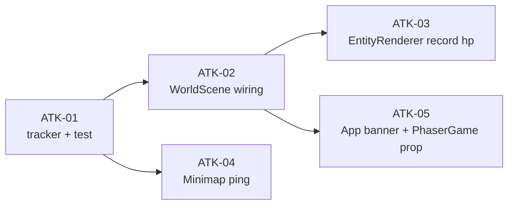

# Phase 12 — Cảnh báo khi bị tấn công (banner + ping minimap)

**Mục tiêu:** khi quân hoặc nhà của người chơi **bị mất máu do địch**, hiện banner cảnh báo
và ping đỏ trên minimap tại vị trí bị đánh. Không thêm âm thanh (hoãn sang `ALERT-02`),
không đổi protocol/server/schema/DB.

**Vấn đề:** state `hp` đã được replicate, nhưng client chỉ vẽ thanh máu nhỏ ở sprite. Người
chơi không có tín hiệu tổng quát: không banner, minimap không nháy, nên rất dễ bị đánh lén
mà không biết. Đây là tính năng phòng thủ cốt lõi của AoE2 ("Your town is under attack").

> **Status: `APPROVED`** (chốt 2026-11-03). Slice `ALERT-01` đã được duyệt; tài liệu này là
> toàn bộ nội dung của bước plan.
>
> Phạm vi: `apps/client` (+ `docs/plans`). **Không** đổi `apps/server`, `packages/shared`,
> schema, protocol hay DB.

---

## 1. Hiện trạng (đối chiếu code)

| Thứ đã có | Chỗ code | Ghi chú |
| --- | --- | --- |
| `hp`/`maxHp` replicate cho unit & building | `apps/server/src/schema/UnitState.ts`, `BuildingState.ts` | client nhận được qua Colyseus |
| Thanh máu nhỏ ở sprite | `render/EntityRenderer.ts:658-685` (`updateUnitBar`), `:330-375` (`updateBuildingBar`) | chỉ hiện khi mất máu; không có tín hiệu tổng quát |
| Banner notification đỏ | `App.tsx:134-138` (`showNotification`), `:737-742` | đang dùng cho `ERROR_NOTIFICATION` từ server; auto-dismiss 3.5 s |
| Minimap vẽ blip theo state mỗi frame | `components/Minimap.tsx:110-220` | có `sceneRef`, đọc `ownerColorCss`; chưa có lớp ping |
| Biết chủ sở hữu của chính mình | `WorldScene.ts:192-205` (`myOwnerId`) | resolve theo `player.name` |
| Ownership marker đã có | `render/ownerColor.ts`, `EntityRenderer.refreshOwner*` | dùng để lọc entity của mình |

| Thứ còn thiếu | Chỗ code | Hệ quả |
| --- | --- | --- |
| Không có detection mất máu của entity mình | `EntityRenderer` onChange chỉ gọi `update*Bar` | mất máu không sinh sự kiện nào khác |
| Không có banner "đang bị đánh" | `App.tsx` | người chơi không được cảnh báo |
| Không có ping minimap | `Minimap.tsx` | không biết chỗ nào bị đánh |
| Không có throttle/cooldown | — | đánh liên tục sẽ spam banner |

**Edge case quan trọng:** `hp` có thể tăng (xây xong, nâng cấp) hoặc giảm (bị đánh). Chỉ **giảm**
mới là bị tấn công. Nâng cấp tăng `maxHp` và `hp` cùng lúc; xây dựng tăng `hp` từ 0 → max.
Không được báo nhầm.

---

## 2. Quyết định thiết kế

### D1 — CHỐT: detection **client-side** qua `hp` replicate, không thêm protocol/server

| Tiêu chí | Client-side (hp onChange) | Server push `UNDER_ATTACK` |
| --- | --- | --- |
| Phạm vi | chỉ client | protocol + server + client |
| Độ tin cậy | phụ thuộc Colyseus patch `hp` trước khi remove | cao hơn, có toạ độ chính xác |
| Chi phí | 0 server | thêm message + throttle server |
| Phù hợp slice | đúng tinh thần "hp đã replicate" | nặng hơn cần thiết cho banner+ping |

→ **Chốt D1: client-side.** Không thêm `NetworkMessage`, không sửa server. Nếu sau này cần độ
tin cậy cao hơn (one-shot kill không kịp patch `hp`), mở rộng thành phase riêng.

### D2 — CHỐT: banner **riêng** (`attackAlert`), không tái dùng `notification` của lỗi

`notification` đang dành cho `ERROR_NOTIFICATION` từ server. Trộn cảnh báo tấn công vào đó sẽ
bị ghi đè bởi lỗi khác và ngược lại. State riêng `attackAlert: boolean`, banner riêng với text
`"Đang bị tấn công!"`, auto-hide 4 s, reset timer khi có damage mới.

### D3 — CHỐT: ping minimap sống **4 s**, banner cooldown **4 s**

Ping đỏ pulse tại toạ độ bị đánh, fade theo tuổi. Banner không spam: chỉ hiện lại khi đã qua
cooldown 4 s kể từ lần hiện trước. Damage liên tục vẫn cập nhật ping (vị trí + thời hạn) nhưng
không tạo banner mới trong cooldown.

### D4 — CHỐT: detection ở `EntityRenderer` onChange + fallback onRemove

`cb.onChange` đã được đăng ký cho cả unit và building, và đã gọi `update*Bar`. Thêm so sánh
`hp` mới với `hp` cũ lưu trong container (`data.lastHp`). Nếu giảm và owner là mình → gọi
`scene.recordEntityHp(...)` → tracker quyết định ping/banner. `onRemove` fallback cho trường hợp
đơn vị bị giết một đòn (hp có thể chưa patch): nếu `hp <= 0` và chủ là mình → ghi nhận ping
tại vị trí cuối.

### D5 — CHỐT: không audio, không trạng thái panel

Audio layer chưa có (`ALERT-02`). Panel "đang bị đánh" hoãn. Phase này chỉ banner + ping.

### D6 — CHỐT: không đổi protocol/schema/DB

Detection dựa trên state đã có. Không cần reset DB.

---

## 3. Task

Size: **S** < 2h, **M** ~ nửa ngày, **L** ≥ 1 ngày.

| Task | Size | Phụ thuộc | Nội dung |
| --- | --- | --- | --- |
| `ATK-01` | S | — | module tracker thuần + unit test |
| `ATK-02` | M | ATK-01 | wiring WorldScene: tracker, callback, removal fallback, clear khi đổi room |
| `ATK-03` | S | ATK-02 | EntityRenderer: record hp lúc tạo + lúc onChange (unit & building) |
| `ATK-04` | S | ATK-01 | Minimap vẽ ping đỏ pulse |
| `ATK-05` | S | ATK-02 | App banner `attackAlert` + PhaserGame prop `onUnderAttack` |

### ATK-01 — `apps/client/src/game/alerts/underAttack.ts` (+ test)

Module thuần, không import Phaser → test bằng vitest như `render/ownerColor.ts` / `cameraInput.ts`.

```ts
export interface AttackPing {
  id: string;
  gx: number;
  gy: number;
  startedAt: number;
  until: number;
}

export interface DamageResult {
  damaged: boolean;
  ping: AttackPing | null;
  showBanner: boolean;
}

export class UnderAttackTracker {
  constructor(
    private readonly bannerCooldownMs: number = 4000,
    private readonly pingLifetimeMs: number = 4000
  ) {}

  /** Track hp for an entity. First call only stores; later calls compare. */
  record(
    entityId: string,
    ownerId: string,
    myOwnerId: string,
    hp: number,
    gx: number,
    gy: number,
    now: number
  ): DamageResult;

  /** Drop tracking for one entity (on remove). */
  forget(entityId: string): void;

  /** Active pings at `now` (prunes expired). */
  activePings(now: number): AttackPing[];

  /** Drop everything (room switch). */
  clear(): void;
}
```

Quy tắc bên trong:

- Luôn lưu `lastHp[entityId] = hp`, kể cả owner không phải mình, để detection đúng khi
  `myOwnerId` resolve muộn.
- `damaged = prev !== undefined && hp < prev`.
- `ping` chỉ tạo khi `damaged && ownerId === myOwnerId && myOwnerId !== ''`; `until = now + pingLifetimeMs`,
  `startedAt = now`; ghi đè ping cũ cùng id.
- `showBanner` chỉ khi có ping và `now - lastBannerAt >= bannerCooldownMs`; khi true đặt
  `lastBannerAt = now`.
- `activePings(now)` trả ping có `until > now`, xoá ping hết hạn.
- `forget` xoá `lastHp` và ping của id.
- `clear` xoá toàn bộ map và reset `lastBannerAt`.

Test (vitest, `node` env): first record no alert; hp drop owned → damaged/ping/banner;
hp drop enemy → no alert nhưng lastHp lưu; hp increase → no alert; banner throttle; ping cập nhật
vị trí khi hit mới; expired pruned; `forget`; `clear`.

### ATK-02 — wiring WorldScene

Sửa `apps/client/src/game/scenes/WorldScene.ts`:

- Import `UnderAttackTracker`.
- Field `public underAttackTracker = new UnderAttackTracker();`
- Field `public onUnderAttack: (() => void) | null = null;`
- Method:
  ```ts
  public recordEntityHp(entityId, ownerId, hp, gx, gy): DamageResult {
    const result = this.underAttackTracker.record(entityId, ownerId, this.myOwnerId, hp, gx, gy, Date.now());
    if (result.showBanner) this.onUnderAttack?.();
    return result;
  }
  public getUnderAttackPings(now = Date.now()): AttackPing[] {
    return this.underAttackTracker.activePings(now);
  }
  ```
- Trong `bindRoomEvents`:
  - `cb.onRemove('units', ...)` và `cb.onRemove('buildings', ...)`: trước destroy, nếu
    `entity.ownerId === this.myOwnerId` và `entity.hp <= 0`, gọi
    `this.recordEntityHp(id, entity.ownerId, 0, gx, gy)` (gx/gy như ATK-03) để fallback one-shot.
  - sau đó `this.underAttackTracker.forget(id)`.
  - Khi bind room mới (`setRoom`/`create`): `this.underAttackTracker.clear()` trước hydrate.
- Export type `AttackPing`/`DamageResult` nếu cần cho Minimap (Minimap chỉ gọi method, không cần type).

**Lưu ý:** `myOwnerId` có thể rỗng lúc remove; tracker vẫn lưu lastHp nhưng không ping. Chấp nhận.

### ATK-03 — EntityRenderer record hp

Sửa `apps/client/src/game/render/EntityRenderer.ts`:

Building:
- Trong `createBuildingSprite`, sau `refreshOwnerBase` và `updateBuildingBar`, gọi
  ```ts
  const gx = building.gridX + building.sizeX / 2;
  const gy = building.gridY + building.sizeY / 2;
  this.scene.recordEntityHp(id, building.ownerId, building.hp, gx, gy);
  container.setData('lastHp', building.hp);
  ```
- Trong `cb.onChange(building, ...)`, trước `updateBuildingBar`, tính `gx/gy` như trên và gọi
  `this.scene.recordEntityHp(id, building.ownerId, building.hp, gx, gy)` (tracker tự so sánh).
  Không cần `lastHp` riêng; tracker giữ.

Unit:
- Trong `createUnitSprite`, sau `refreshOwnerRing`, gọi
  ```ts
  this.scene.recordEntityHp(id, unit.ownerId, unit.hp, unit.x, unit.y);
  ```
- Trong `cb.onChange(unit, ...)`, trước `updateUnitBar`, gọi
  ```ts
  this.scene.recordEntityHp(id, unit.ownerId, unit.hp, unit.x, unit.y);
  ```
  (vị trí dùng `unit.x/y` hiện tại; nếu unit bị đánh khi đứng yên thì đúng; nếu đang di chuyển
  thì ping ở vị trí hiện tại, chấp nhận.)

**Không** gọi record trong vòng lặp `update()` — chỉ trong onChange (đúng convention OWN-05).

### ATK-04 — Minimap ping

Sửa `components/Minimap.tsx`:

- Trong render loop, sau vẽ units (bước 5) và trước camera viewport, thêm:
  ```ts
  const now = Date.now();
  const pings = scene?.getUnderAttackPings?.(now) ?? [];
  pings.forEach((ping: any) => {
    const point = gridToMinimap(ping.gx, ping.gy, width);
    const lifetime = Math.max(1, ping.until - ping.startedAt);
    const age = Math.min(1, (now - ping.startedAt) / lifetime);
    const alpha = 1 - age;
    ctx.save();
    ctx.globalAlpha = alpha;
    ctx.strokeStyle = '#ef4444';
    ctx.fillStyle = 'rgba(239, 68, 68, 0.25)';
    ctx.lineWidth = 2;
    const radius = 4 + age * 8;
    ctx.beginPath();
    ctx.arc(point.x, point.y, radius, 0, Math.PI * 2);
    ctx.stroke();
    ctx.beginPath();
    ctx.arc(point.x, point.y, 2.5, 0, Math.PI * 2);
    ctx.fill();
    ctx.restore();
  });
  ```
- Nếu có ping active, vẽ viền frame minimap màu đỏ thay vì nâu (tuỳ chọn; nếu làm thì restore màu
  gốc khi không có ping). Giữ đơn giản: chỉ ping.

**Lưu ý compact:** cùng code path, không cần nhánh riêng.

### ATK-05 — App banner + wiring

Sửa `apps/client/src/App.tsx`:

- State:
  ```ts
  const [underAttack, setUnderAttack] = useState<boolean>(false);
  const underAttackTimerRef = useRef<number | null>(null);
  const triggerUnderAttack = () => {
    setUnderAttack(true);
    if (underAttackTimerRef.current !== null) window.clearTimeout(underAttackTimerRef.current);
    underAttackTimerRef.current = window.setTimeout(() => setUnderAttack(false), 4000);
  };
  ```
- Cleanup timer trong useEffect unmount.
- Truyền `onUnderAttack={triggerUnderAttack}` cho `PhaserGame`.
- Banner (gần banner notification hiện có):
  ```tsx
  {underAttack && (
    <div className="absolute top-16 left-1/2 -translate-x-1/2 bg-red-950/90 border border-red-500/80 text-red-200 px-4 py-2 rounded shadow-2xl backdrop-blur-md flex items-center gap-2 z-50 text-sm animate-pulse">
      <AlertCircle size={16} className="text-red-400" />
      <span>Đang bị tấn công!</span>
    </div>
  )}
  ```
  (Có thể đặt dưới notification cũ; nếu cả hai cùng hiện, banner tấn công ở `top-24` để không đè.)

Sửa `apps/client/src/game/PhaserGame.tsx`:

- Thêm prop `onUnderAttack: () => void` vào `PhaserGameProps`.
- Ref `onUnderAttackRef`, gán `scene.onUnderAttack = () => onUnderAttackRef.current();` trong bootstrap.

---

## 4. Thứ tự & phụ thuộc



**Phạm vi phase này = 5 commit:**
1. `feat(client): add under-attack tracker for hp loss detection`
2. `feat(client): wire under-attack detection into WorldScene`
3. `feat(client): record entity hp changes in EntityRenderer`
4. `feat(client): draw under-attack ping on minimap`
5. `feat(client): show under-attack banner`

---

## 5. Edge case (kiểm tra khi review)

| # | Tình huống | Kỳ vọng |
| --- | --- | --- |
| 1 | Địch đánh lính/nhà mình | banner xuất hiện, minimap có ping đỏ tại vị trí |
| 2 | Mình đánh lính/nhà địch | không banner, không ping |
| 3 | hp tăng (xây xong, nâng cấp) | không báo nhầm |
| 4 | Foundation đang xây bị đánh | ping tại foundation (hp giảm), banner xuất hiện |
| 5 | Đơn vị bị giết một đòn | fallback onRemove ghi nhận ping tại vị trí cuối |
| 6 | Đánh liên tục 10 s | banner không spam (cooldown 4 s), ping cập nhật vị trí/thời hạn |
| 7 | Đổi room (kingdom ↔ battlefield) | tracker clear, không ping cũ |
| 8 | Reconnect/rejoin | tracker mới, không dính cache cũ |
| 9 | Unit travel (hp > 0, bị remove) | không báo (hp > 0) |
| 10 | Compact minimap (mobile) | ping vẫn vẽ đúng |
| 11 | `myOwnerId` chưa resolve lúc damage | lastHp vẫn lưu; damage sau khi resolve sẽ detection đúng cho các hit sau |
| 12 | Nhiều entity cùng bị đánh | mỗi entity một ping; banner một lần |

---

## 6. Verify

**Bắt buộc:**
1. `cd apps/server && ../../node_modules/.bin/tsc --noEmit` sạch (không sửa server, chạy để chắc).
2. `cd apps/client && ../../node_modules/.bin/tsc --noEmit` sạch.
3. `pnpm --filter @chien-quoc/client test` xanh (có test mới của ATK-01).
4. `pnpm --filter @chien-quoc/server test` xanh.

**Kịch bản tay (A = chủ, B = địch, cùng server `:2567`):**
| Thao tác | Kỳ vọng |
| --- | --- |
| B dẫn lính sang base A và đánh nhà A | A thấy banner "Đang bị tấn công!" + ping đỏ trên minimap tại nhà |
| B giết lính A | banner + ping tại chỗ lính chết |
| A đánh lính B | không banner/ping |
| B đánh liên tục 10 s | banner chỉ hiện lại sau ~4 s, ping không biến mất giữa chừng |
| zoom ra `ZOOM_MIN` | vẫn thấy ping |
| mobile (844×390) | banner + ping không che HUD chính |

---

## 7. Hiệu năng

- Detection chỉ chạy trong `cb.onChange` (Colyseus patch), không trong `update()`.
- Minimap đọc `getUnderAttackPings()` mỗi frame nhưng danh sách nhỏ (≤ số entity đang bị đánh)
  và đã prune hết hạn.
- Ngưỡng: FPS không giảm > 2% so với baseline với ~100 unit; nếu vượt, gộp ping theo ô lưới
  (round gx/gy) thay vì per-entity.

---

## 8. Rủi ro

| Rủi ro | Giảm thiểu |
| --- | --- |
| Colyseus không patch `hp` trước khi remove → miss one-shot kill | fallback onRemove khi `hp <= 0` |
| Báo nhầm khi hp tăng do upgrade | so sánh `hp` mới < `hp` cũ, không xét `maxHp` |
| Travel remove unit hp>0 → không báo | chỉ fallback khi `hp <= 0` |
| Cancel foundation hp>0 → không báo | cùng điều kiện |
| `myOwnerId` chưa resolve → miss cảnh báo đầu | tracker vẫn lưu lastHp; hit sau sẽ detection đúng |
| Ping spam nếu nhiều entity | gộp theo id; cooldown banner |
| Hai banner (error + attack) cùng hiện | attack banner đặt `top-24` khi notification đang hiện |

---

## 9. Ngoài phạm vi (ghi backlog, không làm trong phase)

- **Âm thanh cảnh báo + trạng thái "đang bị đánh" trong panel** (`ALERT-02`): hoãn, repo chưa có
  audio layer.
- Cảnh báo công trình foundation bị phá riêng (`ALERT-03`): cân nhắc sau.
- Server push alert nếu client-side miss one-shot kill: chỉ mở nếu verify cho thấy miss.
- Hiển thị tên người chơi / faction của kẻ tấn công.
- Fog of war / interest management.
- Thay đổi palette màu tương phản / hỗ trợ mù màu.

---

## 10. Definition of Done

- [ ] 4 mục bắt buộc ở §6 đều xanh
- [ ] Kịch bản tay §6 chạy đúng, có screenshot làm bằng chứng
- [ ] Không đụng `NetworkMessage`, `@type()`, schema, DB → **không** cần reset DB
- [ ] Không thêm việc nào vào vòng lặp `update()` (không tra hp mỗi frame)
- [ ] Comment trong code mới viết **tiếng Anh**, có tham chiếu mã task (`ATK-01`…)
- [ ] Mỗi task một commit, message tiếng Anh

---

## 11. Quyết định đã chốt (2026-11-03)

| # | Câu hỏi | Đã chốt | Ghi chú |
| --- | --- | --- | --- |
| 1 | Detection server push hay client-side? | **Client-side** (D1) | hp đã replicate; không đổi protocol |
| 2 | Banner dùng chung notification lỗi? | **Riêng** (D2) | tránh ghi đè |
| 3 | Ping/banner sống bao lâu? | **4 s** (D3) | banner cooldown 4 s |
| 4 | Detection đặt ở đâu? | **EntityRenderer onChange + onRemove fallback** (D4) | không trong update() |
| 5 | Có audio không? | **Không** (D5) | hoãn `ALERT-02` |

---

## 12. Nhật ký

| Ngày | Thay đổi |
| --- | --- |
| 2026-11-03 | Tạo plan: hiện trạng, 5 quyết định, `ATK-01..ATK-05`, edge case, verify, rủi ro. Status `APPROVED` |
