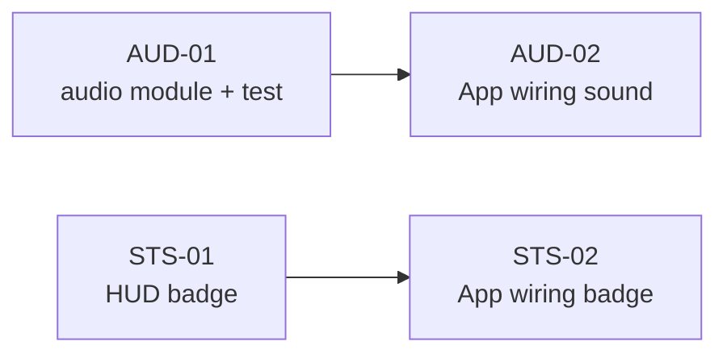

# Phase 14 — Âm thanh cảnh báo + trạng thái "đang bị đánh" trong panel (`ALERT-02`)

**Mục tiêu:** thêm **âm thanh cảnh báo** khi bị tấn công và một **trạng thái "đang bị đánh"**
hiển thị bền vững trong panel HUD, hoàm cùng detection đã có ở phase 12. Không đổi protocol,
server, schema hay DB. Không thêm asset âm thanh (tổng hợp bằng Web Audio API).

**Vấn đề:** phase 12 chỉ có banner 4 s + ping minimap, không có âm thanh và không có tín
hiệu bền vững trong HUD. Người chơi đang làm việc khác (zoom xa, đang xây) dễ bỏ lỡ banner.
Repo chưa có bất kỳ audio layer nào (`grep sound|audio|AudioContext` → 0 hit), và HUD chưa
phản ánh trạng thái bị đánh.

> **Status: `IMPLEMENTED`** (built 2026-11-04). Code + tests green; manual scenario pending verify. Slice `ALERT-02` built from this plan. Slice cha: phase 12 (under-attack alert), đã shipped PR #5.

Phạm vi: `apps/client` (+ `docs/plans`). **Không** đổi `apps/server`, `packages/shared`,
schema, protocol hay DB. Không thêm file asset.

---

## 1. Hiện trạng (đối chiếu code)

| Thứ đã có | Chỗ code | Ghi chú |
| --- | --- | --- |
| Detection HP mất + banner 4 s | `App.tsx:114-155`, `game/alerts/underAttack.ts` | `underAttack` boolean, auto-hide 4 s |
| Callback scene → React | `WorldScene.onUnderAttack`, `PhaserGame.tsx:139` | chỉ gọi khi `showBanner` (cooldown 4 s) |
| Ping minimap 4 s | `Minimap.tsx:230-255` | pulse đỏ tại toạ độ bị đánh |
| HUD identity + network status | `components/HUD.tsx` | chưa có trạng thái bị đánh |
| Audio layer | — | không có; không có `AudioContext` usage |

| Thứ còn thiếu | Hệ quả |
| --- | --- |
| Không có module phát âm thanh | không thể cảnh báo khi người chơi không nhìn màn hình |
| HUD không phản ánh bị đánh | banner biến mất sau 4 s, không còn tín hiệu |
| Không có mute/volume UI | chấp nhận; dùng mute của trình duyệt/tab |

**Edge case quan trọng:** `triggerUnderAttack` chỉ được gọi khi tracker quyết định
`showBanner = true` (cooldown 4 s), nên âm thanh và banner đã tự throttle. Không cần throttle
riêng ở audio. AudioContext có thể bị suspended trước tương tác người dùng → phải `resume()`.

---

## 2. Quyết định thiết kế

### D1 — CHỐT: audio **tổng hợp bằng Web Audio API**, không thêm asset

Repo không có pipeline asset âm thanh, và AGENTS.md cấm tự vẽ/tạo art không có nguồn. Âm thanh
cảnh báo là tín hiệu chức năng, không phải art: tổng hợp một tiếng bíp ngắn (square wave
880 → 660 Hz, ~220 ms, gain envelope) bằng `AudioContext`. Không thêm file `.mp3/.wav`, không
đụng `public/assets`. Nếu sau này muốn âm thanh AoE-style thật, thay module này bằng loader
asset trong phase riêng.

| Phương án | Web Audio (chọn) | Asset file + `<audio>` |
| --- | --- | --- |
| Asset mới | Không | Có (cần nguồn/licence) |
| Test được | Có (inject factory) | Khó (I/O, decode) |
| Autoplay policy | resume() rõ ràng | Tương tự |
| Phù hợp slice S | Có | Nặng hơn |

→ Chốt: Web Audio.

### D2 — CHỐT: một `AudioContext` dùng lại, lazy-create

Tạo context ở lần gọi đầu tiên (sau tương tác người dùng: login/join), giữ singleton trong
module. Nếu `AudioContext`/`webkitAudioContext` không tồn tại → no-op (không crash). Nếu context
`state === 'suspended'` → gọi `resume()` (fire-and-forget, nuốt lỗi). Không close context khi
unmount (tránh tạo lại); chỉ no-op nếu không có window.

### D3 — CHỐT: trạng thái bị đánh là **badge bền vững** trong HUD, không thay banner

Banner transient 4 s giữ nguyên. Thêm prop `underAttack?: boolean` vào `HUD`. Khi true:
- Desktop: badge đỏ pulse `"ĐANG BỊ TẤN CÔNG"` cạnh indicator network (góc phải HUD).
- Compact: chấm đỏ pulse trong identity chip (không thêm chữ để không tràn).

Badge theo cùng timer 4 s với banner (đơn giản, không thêm state). Nếu cần "đang bị đánh" bền
vững hơn (theo ping active), mở rộng sau; slice này giữ đồng bộ với banner để tránh hai clock.

### D4 — CHỐT: âm thanh gọi ở `triggerUnderAttack`, không ở scene

`triggerUnderAttack` đã là điểm tập trung banner. Thêm `playUnderAttackAlert()` vào đó. Vì callback
scene chỉ fire khi `showBanner`, âm thanh tự theo cooldown 4 s. Không truyền audio qua PhaserGame
hay scene (tránh coupling).

### D5 — CHỐT: không mute/volume UI trong slice này

Không có settings panel hiện có. Mute dùng mute của trình duyệt/tab. Thêm UI mute là scope riêng
nếu cần. Module vẫn expose `setEnabled(boolean)` để caller tương lai tắt; mặc định `true`.

### D6 — CHỐT: không đổi tracking/bannner/minimap

Phase 12 giữ nguyên. Chỉ thêm audio + HUD badge. Không đụng `UnderAttackTracker`, `EntityRenderer`,
`Minimap`.

---

## 3. Task

Size: **S** < 2h, **M** ~ nửa ngày, **L** ≥ 1 ngày.

| Task | Size | Phụ thuộc | Nội dung |
| --- | --- | --- | --- |
| ✅ `AUD-01` | S | — | module audio Web Audio + unit test (node env, fake context) |
| ✅ `AUD-02` | S | AUD-01 | wiring `triggerUnderAttack` gọi `playUnderAttackAlert()` |
| ✅ `STS-01` | S | — | HUD badge "đang bị đánh" (desktop + compact) + prop `underAttack` |
| ✅ `STS-02` | S | STS-01 | App truyền `underAttack` cho HUD |

### AUD-01 — `apps/client/src/game/audio/alertSound.ts` (+ test)

Module thuần, không import Phaser/React → test bằng vitest node env với fake `AudioContext`.

```ts
export interface AudioContextLike {
  state: 'suspended' | 'running' | 'closed';
  currentTime: number;
  createOscillator(): OscillatorNodeLike;
  createGain(): GainNodeLike;
  resume(): Promise<void>;
  destination: unknown;
}

export interface AlertSoundOptions {
  /** Master enable switch; defaults to true. */
  enabled?: boolean;
}

export class UnderAttackSound {
  constructor(
    private readonly contextFactory: () => AudioContextLike | null = defaultFactory,
    private enabled: boolean = true
  ) {}

  setEnabled(enabled: boolean): void;
  play(): void; // no-op if disabled / no context / play throws
}

export function playUnderAttackAlert(): void; // uses module singleton
```

Quy tắc bên trong:
- `play()` lazy-create context qua `contextFactory`; nếu null → return.
- Nếu `context.state === 'suspended'` → `void context.resume().catch(() => {})`.
- Tạo oscillator square 880 → 660 Hz, gain 0 → 0.2 → 0 trong ~220 ms, connect gain → destination,
  `start()`/`stop()` với try/catch (một số trình duyệt throw nếu stop trước start).
- Bọc toàn bộ trong try/catch → không bao giờ throw ra caller.
- `setEnabled` chỉ đổi flag; không đụng context.

Test (vitest, node env): no context → no throw; disabled → factory không gọi; enabled → factory gọi
1 lần, oscillator start/stop được gọi; suspended → resume gọi; play hai lần dùng lại cùng context.

### AUD-02 — wiring App

Sửa `apps/client/src/App.tsx`:
- Import `{ playUnderAttackAlert } from './game/audio/alertSound.js'`.
- Trong `triggerUnderAttack`, sau `setUnderAttack(true)`, gọi `playUnderAttackAlert()`.
- (Tuỳ chọn) cleanup không cần; singleton sống cùng tab.

**Không** thay đổi timer logic.

### STS-01 — HUD badge

Sửa `apps/client/src/components/HUD.tsx`:
- Thêm prop `underAttack?: boolean` (default false).
- Desktop: trong cụm network status (góc phải), nếu `underAttack` thì hiển thị badge đỏ pulse
  `"ĐANG BỊ TẤN CÔNG"` (text-xs, `animate-pulse`, border red) bên trái indicator ONLINE.
- Compact: trong identity chip, nếu `underAttack` thì chấm đỏ pulse (`bg-red-500 animate-pulse`)
  thay/augment chấm zone; giữ kích thước.

**Không** thêm prop mới vào Minimap hay PhaserGame.

### STS-02 — App wiring

Sửa `apps/client/src/App.tsx`:
- Truyền `underAttack={underAttack}` cho `<HUD ... />` (cả desktop/compact đều dùng cùng component).

---

## 4. Thứ tự & phụ thuộc



`AUD-01` và `STS-01` độc lập, có thể làm song song. `AUD-02`/`STS-02` phụ thuộc tương ứng.

**Phạm vi phase này = 4 commit:**
1. `feat(client): add Web Audio under-attack alert sound`
2. `feat(client): play alert sound when under attack`
3. `feat(client): show under-attack status badge in HUD`
4. `feat(client): wire under-attack status into HUD`

---

## 5. Edge case (kiểm tra khi review)

| # | Tình huống | Kỳ vọng |
| --- | --- | --- |
| 1 | Địch đánh nhà/lính mình | banner + ping + bíp + badge HUD đỏ |
| 2 | Mình đánh địch | không bíp, không badge |
| 3 | hp tăng (xây xong, nâng cấp) | không bíp |
| 4 | Đánh liên tục 10 s | bíp + badge theo cooldown 4 s (không spam) |
| 5 | Tab mute / context suspended | bíp không phát, không crash; badge vẫn hiện |
| 6 | Trình duyệt không hỗ trợ AudioContext | no-op; badge vẫn hiện |
| 7 | Đổi room | tracker clear (phase 12); badge tắt theo timer |
| 8 | Mobile compact | badge dạng chấm đỏ, không tràn HUD |
| 9 | Hai banner (error + attack) cùng hiện | badge vẫn hiện cạnh network status |
| 10 | `play()` ném exception | nuốt lỗi; banner/HUD không bị ảnh hưởng |

---

## 6. Verify

**Bắt buộc:**
1. `cd apps/server && ../../node_modules/.bin/tsc --noEmit` sạch (không sửa server, chạy để chắc).
2. `cd apps/client && ../../node_modules/.bin/tsc --noEmit` sạch.
3. `pnpm --filter @chien-quoc/client test` xanh (có test mới của AUD-01).
4. `pnpm --filter @chien-quoc/server test` xanh.

**Kịch bản tay (A = chủ, B = địch, cùng server `:2567`):**
| Thao tác | Kỳ vọng |
| --- | --- |
| B đánh nhà A | A nghe bíp, thấy badge đỏ "ĐANG BỊ TẤN CÔNG" ~4 s, banner + ping như phase 12 |
| B đánh liên tục 10 s | bíp lặp mỗi ~4 s, badge không nhấp nháy loạn |
| Tắt tab sound (mute) | không nghe bíp, không lỗi console |
| Mobile landscape | chấm đỏ pulse trong HUD, bíp phát (nếu tab không mute) |
| A đánh lính B | không bíp, không badge |

---

## 7. Hiệu năng

- Audio chỉ chạy khi `showBanner` (≤ 1 lần/4 s), chi phí Web Audio negligible.
- HUD badge là conditional render theo boolean, không thêm effect/polling.
- Ngưỡng: FPS không đổi; nếu AudioContext resume chậm, không block main thread (fire-and-forget).

---

## 8. Rủi ro

| Rủi ro | Giảm thiểu |
| --- | --- |
| Autoplay policy chặn context trước tương tác | lazy-create sau login/join; resume() fire-and-forget; no-op nếu fail |
| AudioContext không tồn tại (SSR/old browser) | feature-detect; badge vẫn hoạt động |
| `play()` ném (một số browser) | try/catch toàn bộ |
| Bíp khó chịu / spam | theo cooldown banner 4 s; D5 không mute UI (chấp nhận) |
| Badge desync với banner (hai timer) | cùng `underAttack` state và timer 4 s trong App |

---

## 9. Ngoài phạm vi (ghi backlog, không làm trong phase)

- Mute/volume UI và settings panel.
- Âm thanh AoE-style thật từ file asset + pipeline licence.
- Status bền vững theo ping active (thay vì timer 4 s).
- Nút "nhảy tới chỗ bị đánh" (center camera on last ping).
- Cảnh báo công trình foundation bị phá riêng (`ALERT-03`).
- Server push alert nếu client-side miss one-shot kill.

---

## 10. Definition of Done

- [x] 4 mục bắt buộc ở §6 đều xanh
- [ ] Kịch bản tay §6 chạy đúng, có bằng chứng (screenshot/video)
- [x] Không đụng server/shared/schema/protocol/DB/assets
- [x] Audio module không throw trong node env (test xanh)
- [x] Comment trong code mới viết **tiếng Anh**, có tham chiếu mã task (`AUD-01`…, `STS-01`…)
- [ ] Mỗi task một commit, message tiếng Anh

---

## 11. Quyết định đã chốt (2026-11-04)

| # | Câu hỏi | Đã chốt | Ghi chú |
| --- | --- | --- | --- |
| 1 | Audio từ asset hay tổng hợp? | **Web Audio tổng hợp** (D1) | không thêm asset |
| 2 | Context lifecycle? | **Singleton lazy + resume** (D2) | không close khi unmount |
| 3 | Trạng thái bị đánh ở đâu? | **Badge HUD** (D3) | desktop + compact |
| 4 | Gọi audio ở đâu? | **`triggerUnderAttack`** (D4) | theo cooldown banner |
| 5 | Mute UI? | **Không** (D5) | dùng mute trình duyệt |
| 6 | Có đổi tracking/bannner/minimap? | **Không** (D6) | chỉ thêm audio + badge |

---

## 12. Nhật ký

| Ngày | Thay đổi |
| --- | --- |
| 2026-11-04 | Tạo plan: hiện trạng, 6 quyết định, `AUD-01..AUD-02`, `STS-01..STS-02`, edge case, verify, rủi ro. Status `APPROVED` |
| 2026-11-04 | Built: `alertSound.ts` + test, App wiring, HUD badge. tsc client/server clean; client 373 tests, server 167 tests. Status `IMPLEMENTED`. |
