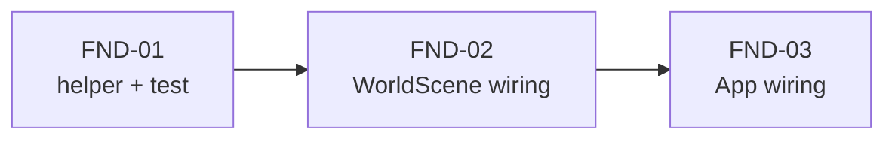

# Phase 15 — Cảnh báo khi công trình foundation bị phá (`ALERT-03`)

**Mục tiêu:** bảo đảm người chơi được cảnh báo (banner + ping minimap + bíp + badge HUD)
khi **công trình đang xây (foundation) của mình bị phá**, dù client không kịp nhận patch
`hp` trước khi server xoá entity. Tái dùng detector của phase 12, không thêm protocol,
server, schema hay DB, không thêm asset.

**Vấn đề:** foundation có `hp = 1` và `maxHp` đầy đủ, nhưng thanh máu riêng không được vẽ
(trong `updateBuildingBar`, nhánh `!isConstructed` vẽ thanh tiến độ xây vàng thay cho HP).
Khi địch phá foundation, server xoá entity gần như ngay lập tức; patch `hp` có thể không
kịp tới client, nên fallback onRemove của phase 12 (chỉ kích hoạt khi `hp <= 0`) bỏ sót,
vì object bị xoá vẫn còn `hp = 1`. Đây là trường hợp phòng thủ dễ bị đánh lén nhất:
công trình đang xây gần như không có máu nhưng người chơi không biết nó bị đập.

> **Status: `APPROVED`** (chốt 2026-11-04). Slice `ALERT-03` đã được duyệt; tài liệu này là
> toàn bộ nội dung của bước plan. Slice cha: phase 12 (under-attack alert), đã shipped PR #5;
> phase 14 (audio + badge) đã shipped/implemented.

Phạm vi: `apps/client` (+ `docs/plans`). **Không** đổi `apps/server`, `packages/shared`,
schema, protocol, DB, asset.

---

## 1. Hiện trạng (đối chiếu code)

| Thứ đã có | Chỗ code | Ghi chú |
| --- | --- | --- |
| Detector HP mất + banner 4 s + ping minimap | `game/alerts/underAttack.ts`, `App.tsx`, `Minimap.tsx` | phase 12, shipped PR #5 |
| Audio bíp + badge HUD | `game/audio/alertSound.ts`, `HUD.tsx` | phase 14, implemented |
| Record HP khi create/onChange building | `render/EntityRenderer.ts` (ATK-03) | seed `hp` ban đầu, gọi `scene.recordEntityHp` |
| Fallback one-shot kill onRemove | `WorldScene.ts` onRemove `buildings`/`units` | chỉ kích hoạt nếu `ownerId === myOwnerId && hp <= 0` |
| Foundation `hp = 1`, `maxHp` đầy | `server/.../CommandSystem.ts` placement | gần như không máu cho đến khi xây xong |
| Thanh tiến độ thay cho HP khi chưa xây xong | `EntityRenderer.updateBuildingBar` | không có thanh HP riêng cho foundation |
| Huỷ foundation của chính mình | `App.tsx` `handleCancelFoundation` → `CANCEL_BUILDING` | server xoá entity; không nên báo tấn công |

| Thứ còn thiếu | Hệ quả |
| --- | --- |
| Fallback không nhận diện foundation bị phá | foundation bị đập mà không banner/ping/bíp |
| Không phân biệt "bị địch phá" với "chính mình huỷ" | nếu mở rộng fallback thẳng, huỷ foundation của mình cũng bị báo nhầm |
| Không có điều kiện thuần để test | logic nằm trong `cb.onRemove`, khó unit-test |

**Edge case quan trọng:** foundation có `hp = 1` nên **mọi đòn đánh đều phá huỷ ngay**;
không có trạng thái "mất một phần máu". Vì thế detection phải dựa vào **sự biến mất**
của entity, không phải vào patch `hp`. Phase 12 đã làm fallback onRemove cho unit/building
khi `hp <= 0`; ALERT-03 mở rộng fallback đó cho foundation và loại trừ trường hợp chính
mình huỷ.

---

## 2. Quyết định thiết kế

### D1 — CHỐT: vẫn client-side, tái dùng detector phase 12

Không thêm protocol/server. Server đã xoá entity; client chỉ cần nhận diện removal và gọi
`recordEntityHp(id, ownerId, 0, gx, gy)` để tracker so sánh `lastHp (1)` → `0` và sinh
ping/banner. Audio/badge tự theo `triggerUnderAttack` (cooldown 4 s).

### D2 — CHỐT: foundation bị phá = mọi removal của foundation của mình **trừ khi chính mình huỷ**

Foundation chỉ bị xoá trong hai trường hợp runtime: (a) địch phá, (b) chủ huỷ (cancel).
(a) phải báo, (b) không báo. Phân biệt bằng tập `cancelledFoundations` ở scene, được đánh
dấu từ `handleCancelFoundation` trước khi gửi lệnh. Room switch/reconnect không báo vì tracker
đã `clear()` và `lastHp` không còn.

### D3 — CHỐT: không thêm thanh HP riêng cho foundation

Foundation sống rất ngắn (bị phá trong một đòn) nên thanh HP không kịp đọc. Tín hiệu tổng
quát (banner/ping/bíp/badge) là đủ. Nếu sau này muốn thanh HP cho foundation đang bị đánh,
mở phase riêng; không làm trong slice này.

### D4 — CHỐT: điều kiện fallback đặt trong helper thuần test được

Tách `shouldAlertOnBuildingRemoval(building, myOwnerId, cancelled)` ra module riêng
`game/alerts/foundationRemoval.ts`, không import Phaser, để unit-test bằng vitest như
`underAttack.ts` và `ownerColor.ts`. `WorldScene` chỉ gọi helper + tracker.

### D5 — CHỐT: không đổi tracker API

`UnderAttackTracker.record(...)` đã đủ: `lastHp = 1` → `hp = 0` là `damaged = true`.
Không thêm method mới; tránh phình API. Chỉ mở rộng điều kiện gọi ở scene.

### D6 — CHỐT: huỷ của chính mình được đánh dấu lạc quan + tự hết hạn

`handleCancelFoundation` gọi `scene.markFoundationCancelled(id)` rồi gửi `CANCEL_BUILDING`.
Set này được xoá khi onRemove xử lý id đó; nếu server từ chối (foundation đã xây xong) thì
set tự hết hạn sau 2 s để không làm lỡ cảnh báo sau này.

---

## 3. Task

Size: **S** < 2h, **M** ~ nửa ngày, **L** ≥ 1 ngày.

| Task | Size | Phụ thuộc | Nội dung |
| --- | --- | --- | --- |
| `FND-01` | S | — | helper thuần `shouldAlertOnBuildingRemoval` + unit test |
| `FND-02` | S | FND-01 | WorldScene: onRemove buildings dùng helper + tập `cancelledFoundations`; clear khi đổi room/reset |
| `FND-03` | S | FND-02 | App: `handleCancelFoundation` đánh dấu cancelled; scene method `markFoundationCancelled` |

### FND-01 — `apps/client/src/game/alerts/foundationRemoval.ts` (+ test)

Module thuần, không import Phaser/React.

```ts
export interface RemovableBuilding {
  ownerId?: string;
  hp?: number;
  isConstructed?: boolean;
}

export function shouldAlertOnBuildingRemoval(
  building: RemovableBuilding | null | undefined,
  myOwnerId: string,
  cancelled: boolean
): boolean;
```

Quy tắc:

- `false` nếu `building` null/undefined, `myOwnerId` rỗng, hoặc `building.ownerId !== myOwnerId`.
- `false` nếu `cancelled === true` (chính mình huỷ).
- Nếu `building.isConstructed === true`: chỉ `true` khi `(building.hp ?? 0) <= 0` (giữ nguyên
  hành vi phase 12 cho nhà đã xây xong).
- Nếu `building.isConstructed === false` (foundation) hoặc không xác định: `true`
  (foundation bị phá trong một đòn; mọi removal không do mình huỷ đều là bị đánh).

Test (vitest, node env): null → false; owner khác → false; myOwnerId rỗng → false;
cancelled → false; nhà đã xây, hp>0 → false; nhà đã xây, hp<=0 → true; foundation, hp=1 → true;
foundation, cancelled → false.

### FND-02 — wiring WorldScene

Sửa `apps/client/src/game/scenes/WorldScene.ts`:

- Import `shouldAlertOnBuildingRemoval`.
- Field `private cancelledFoundations = new Set<string>();`.
- Method:
  ```ts
  public markFoundationCancelled(id: string): void {
    this.cancelledFoundations.add(id);
    // FND-06: self-heal if the server rejects the cancel (already constructed).
    window.setTimeout(() => this.cancelledFoundations.delete(id), 2000);
  }
  ```
- Trong `cb.onRemove('buildings', ...)`:
  ```ts
  const cancelled = this.cancelledFoundations.has(key);
  const shouldAlert = shouldAlertOnBuildingRemoval(building, this.myOwnerId, cancelled);
  if (shouldAlert) {
    const gx = (building?.gridX ?? 0) + (building?.sizeX ?? 1) / 2;
    const gy = (building?.gridY ?? 0) + (building?.sizeY ?? 1) / 2;
    this.recordEntityHp(key, building.ownerId, 0, gx, gy);
  } else {
    this.underAttackTracker.forget(key);
  }
  this.cancelledFoundations.delete(key);
  ```
  (giữ nguyên phần destroy sprite + selection cleanup.)
- Trong `setRoom` và `resetForNewWorld`: `this.cancelledFoundations.clear();` bên cạnh
  `this.underAttackTracker.clear();`.

**Lưu ý:** tracker đã `clear()` khi đổi room, nên `record` với `lastHp` không còn sẽ không
sinh ping (damaged false). Điều này bảo vệ false positive khi travel/reconnect.

### FND-03 — wiring App

Sửa `apps/client/src/App.tsx`:

- Trong `handleCancelFoundation`, trước `room.send(...)`, gọi
  ```ts
  sceneRef.current?.markFoundationCancelled(buildingId);
  ```

Không thay đổi timer/notification logic. Audio/badge/HUD theo phase 14 không đổi.

---

## 4. Thứ tự & phụ thuộc



**Phạm vi phase này = 3 commit:**
1. `feat(client): add foundation removal alert condition helper`
2. `feat(client): alert when own foundation is destroyed`
3. `feat(client): mark locally cancelled foundations`

---

## 5. Edge case (kiểm tra khi review)

| # | Tình huống | Kỳ vọng |
| --- | --- | --- |
| 1 | Địch phá foundation của mình | banner + ping tại foundation + bíp + badge HUD |
| 2 | Mình huỷ foundation của mình | không banner/ping/bíp/badge |
| 3 | Địch phá nhà đã xây xong (hp<=0) | vẫn báo (hành vi phase 12 giữ nguyên) |
| 4 | Mình phá nhà địch | không báo |
| 5 | hp tăng (xây xong, nâng cấp) | không báo nhầm |
| 6 | Foundation bị phá một đòn (không patch hp) | fallback onRemove sinh ping (lastHp=1 → 0) |
| 7 | Foundation bị phá và patch hp kịp tới | onChange đã sinh ping; onRemove không sinh ping thứ hai (0 không < lastHp đã <=0) |
| 8 | Đổi room (kingdom ↔ battlefield) | tracker clear; không ping cũ; `cancelledFoundations` clear |
| 9 | Reconnect/rejoin | tracker mới; không dính cache cũ |
| 10 | Huỷ foundation bị server từ chối (đã xây xong) | set tự hết hạn 2 s; không làm lỡ cảnh báo sau |
| 11 | Nhiều foundation cùng bị đánh | mỗi foundation một ping; banner theo cooldown |
| 12 | Mobile compact | ping/banner/badge vẫn hoạt động như phase 12/14 |
| 13 | Foundation bị phá khi `myOwnerId` chưa resolve | lastHp vẫn lưu từ seed; nếu resolve muộn thì các hit sau detection đúng; removal fallback gọi record với ownerId foundation, tracker so sánh với myOwnerId hiện tại |

---

## 6. Verify

**Bắt buộc:**
1. `cd apps/server && ../../node_modules/.bin/tsc --noEmit` sạch (không sửa server, chạy để chắc).
2. `cd apps/client && ../../node_modules/.bin/tsc --noEmit` sạch.
3. `pnpm --filter @chien-quoc/client test` xanh (có test mới của FND-01).
4. `pnpm --filter @chien-quoc/server test` xanh.

**Kịch bản tay (A = chủ, B = địch, cùng server `:2567`):**
| Thao tác | Kỳ vọng |
| --- | --- |
| A đặt foundation, B dẫn lính tới đập | A thấy banner "Đang bị tấn công!" + ping đỏ tại foundation + bíp + badge HUD |
| A đặt foundation rồi huỷ (cancel) | không banner/ping/bíp/badge |
| A đặt foundation, để xây gần xong, B đập | foundation hp=1 nên vẫn bị phá một đòn; cảnh báo xuất hiện |
| A đánh lính B | không cảnh báo |
| Mobile landscape (844×390) | ping + badge không che HUD |

---

## 7. Hiệu năng

- Không thêm polling hay `update()`; detection vẫn chỉ ở `cb.onChange`/`cb.onRemove`.
- Helper là pure function, chi phí O(1).
- `cancelledFoundations` là Set nhỏ, tự xoá khi onRemove.
- Ngưỡng: FPS không đổi so với phase 12; nếu vượt, gộp ping theo ô lưới như phase 12 §7.

---

## 8. Rủi ro

| Rủi ro | Giảm thiểu |
| --- | --- |
| Colyseus không gửi `isConstructed` trong onRemove | helper coi `isConstructed !== true` là foundation → vẫn báo; an toàn (false positive chỉ khi huỷ, đã guard bằng cancelled) |
| Huỷ của mình bị báo nhầm | guard `cancelledFoundations` + timeout tự hết hạn |
| Room switch kích hoạt onRemove trước `clear()` | `clear()` gọi trước reset; tracker rỗng → `record` không sinh ping |
| Huỷ bị server từ chối để set sót | timeout 2 s xoá set |
| Double alert khi patch hp kịp tới | `record(0)` với `lastHp` đã <=0 không `damaged` |
| `markFoundationCancelled` gọi khi scene null (React StrictMode) | optional chaining `sceneRef.current?.` |

---

## 9. Ngoài phạm vi (ghi backlog, không làm trong phase)

- Thanh HP riêng cho foundation khi đang bị đánh (D3).
- Âm thanh AoE-style từ file asset (phase 14 hoãn).
- Server push alert nếu client-side miss (phase 12 hoãn).
- Hiển thị tên/faction kẻ tấn công.
- Fog of war / interest management.

---

## 10. Definition of Done

- [x] 4 mục bắt buộc ở §6 đều xanh (server tsc, client tsc, client test, server test)
- [ ] Kịch bản tay §6 chạy đúng, có bằng chứng (screenshot/video)
- [x] Không đụng server/shared/schema/protocol/DB/assets → **không** cần reset DB
- [x] Helper `shouldAlertOnBuildingRemoval` có unit test xanh
- [x] Không thêm việc nào vào vòng lặp `update()`
- [x] Comment trong code mới viết **tiếng Anh**, có tham chiếu mã task (`FND-01`…)
- [ ] Mỗi task một commit, message tiếng Anh (deferred to ship step)

---

## 11. Quyết định đã chốt (2026-11-04)

| # | Câu hỏi | Đã chốt | Ghi chú |
| --- | --- | --- | --- |
| 1 | Detection server push hay client-side? | **Client-side** (D1) | tái dùng phase 12 |
| 2 | Foundation có thanh HP riêng? | **Không** (D3) | alert tổng quát đủ |
| 3 | Phân biệt huỷ của mình thế nào? | **Set cancelled + timeout** (D2, D6) | không đổi protocol |
| 4 | Điều kiện fallback đặt ở đâu? | **Helper thuần** (D4) | test được |
| 5 | Có đổi tracker API? | **Không** (D5) | reuse `record` |

---

## 12. Nhật ký

| Ngày | Thay đổi |
| --- | --- |
| 2026-11-04 | Tạo plan: hiện trạng, 6 quyết định, `FND-01..FND-03`, edge case, verify, rủi ro. Status `APPROVED` |
| 2026-11-04 | Build `ALERT-03`: thêm `foundationRemoval.ts` + test, wiring WorldScene/App. Client 383 tests, server 167 tests, tsc clean. |
