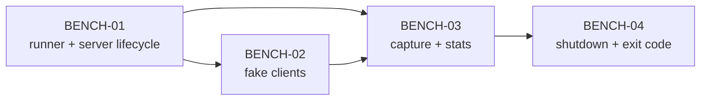

# Phase 16 — Benchmark autosave: spawn N client giả, đo p95 (`SAVE-06`)

**Mục tiêu:** có một script chạy **local**, không đụng runtime, spawn N client giả vào server thật,
giữ kết nối đủ lâu để autosave 30 s chạy nhiều chu kỳ, và tổng hợp p50/p95 thời gian lưu +
số statement từ log server. Đây là điều kiện mở `SAVE-02..05` (phase 10 §7) và trả lời câu hỏi
"autosave có phải nút thắt thật không" bằng số đo, không phải ước lượng.

> **Status: `IMPLEMENTED`** (built 2026-11-04). Code + tests green; manual scenario pending verify. Slice `SAVE-06` built from this plan. Slice cha: phase 10 (persistence scaling), còn `DRAFT`; phụ thuộc `SAVE-01` đã shipped PR #6 (log ms + stmts đã có).

Phạm vi: `scripts/` (+ `docs/plans`). **Không** đổi `apps/server`, `apps/client`,
`packages/shared`, schema, protocol hay DB. Không thêm dependency mới (dùng `@colyseus/sdk`
đã có trong `apps/client/node_modules`).

---

## 1. Mục tiêu

1. Chạy được bằng một lệnh, không cần sửa code server/client.
2. Spawn được N account + room (mặc định N = 10) và giữ kết nối ít nhất 2 chu kỳ autosave
   (mặc định 90 s) để có ≥ 3 mẫu/zone.
3. Parse log autosave hiện có (`💾 [DatabaseService] ... ms, ... stmts`) và tính min/p50/p95/max/mean
   cho battlefield và kingdom, kèm số statement trung bình.
4. In bảng tổng hợp ra console và ghi JSON ra file để đưa vào phase 10 §4 (thay "ước lượng").
5. Kết thúc sạch: ngắt client, dừng server spawn, không treo process.

---

## 2. Hiện trạng (đối chiếu code)

| Thành phần | Hành vi | Vị trí |
| --- | --- | --- |
| Log autosave | `💾 [DatabaseService] ${zone} auto-saved (Players: ..., Buildings: ..., Units: ..., ${ms} ms, ${n} stmts)` | `DatabaseService.ts:723-732` |
| Autosave | Mỗi room 30 s, `skipIfBusy` | `WorldRoom.ts:352-354`, `WorldRoom.ts:1080-1093` |
| Room layout | 1 kingdom room/tài khoản + 1 battlefield chung | `index.ts:111-112` |
| Auth HTTP | `POST /auth/register`, `POST /auth/login` trả `{ user, token }` | `index.ts`, `AuthService.ts` |
| Colyseus join | `client.joinOrCreate('kingdom_room', { ownerId, force })` / `'battlefield_room'` | `App.tsx:220-233` |
| Health | `GET /health` → `{ status: "ok" }` | `index.ts` |
| DB file | Cố định `apps/server/database/dev.db` (không có env override) | `DatabaseService.ts:21-22` |
| Script mẫu client thật | `apps/server/probe-auth.mjs` (cũ, dùng `world_room`) | `probe-auth.mjs` |

Hệ quả cho benchmark:

- Muốn có battlefield autosave phải có ít nhất một client join `battlefield_room`; nếu chỉ join
  kingdom thì battlefield room không tồn tại và không có mẫu battlefield.
- Một account chỉ nên ở **một** room tại một thời điểm (session gate process-wide); vì vậy
  battlefield phải do một account riêng xử lý, không phải account đang ở kingdom.
- DB file không cấu hình được qua env, nên benchmark chạy trên DB dev hiện có; account benchmark
  dùng prefix `bench_` để nhận diện và dọn sau.

---

## 3. Quyết định thiết kế

### D1 — CHỐT: script spawn chính server, không yêu cầu server chạy sẵn

Script ở chế độ mặc định (`--server spawn`) tự spawn server con, đọc stdout/stderr để parse log,
và tắt server khi xong. Chế độ `--server external` chỉ dùng khi người dùng đã có server và chấp
nhận **không** có số đo (không parse được log của process khác) — chế độ này chỉ để kiểm tra
kết nối. Lý do không tail log file: server không ghi file log; pipe là nguồn đáng tin cậy nhất.

| Phương án | Spawn server (chọn) | Server có sẵn |
| --- | --- | --- |
| Có log ms/stmts | Có (pipe stdout) | Không (không capture được) |
| Setup | Script tự lo build/prisma | Người dùng tự chạy |
| Rủi ro dev.db | Cùng file dev.db | Cùng file dev.db |
| Phù hợp "chỉ chạy local" | Có | Một phần |

→ Chốt: spawn server mặc định.

### D2 — CHỐT: spawn server bằng tsx trực tiếp, không build trước

Dùng `pnpm --filter @chien-quoc/server exec tsx src/index.ts` (cwd `apps/server`) để tránh bước
build và phản ánh code đang sửa. Script kiểm tra Prisma client đã generate; nếu chưa thì chạy
`pnpm --filter @chien-quoc/server run prisma:generate` trước. Không dùng `dev` (tsx watch) vì
watch có thể restart khi file thay đổi giữa run.

### D3 — CHỐT: fake client dùng `@colyseus/sdk`, không dùng browser

Import `Client` từ `apps/client/node_modules/@colyseus/sdk`. Mỗi client:

1. `POST /auth/register` với username `bench_<runId>_<i>`; nếu 409 thì `POST /auth/login`.
2. `client.auth.token = token`.
3. `await client.joinOrCreate('kingdom_room', { ownerId: user.id })`.
4. Giữ kết nối idle (không gửi command) trong suốt thời gian đo.

Idle client vẫn làm server tạo room, generate map và autosave — đúng mục tiêu đo autosave.
Không cần điều khiển unit/building; entity ban đầu đã đủ (TC, tài nguyên ~260 node).

### D4 — CHỐT: battlefield đo bằng một account riêng

Mặc định `--battlefield` bật: đăng ký thêm account `bench_<runId>_bf`, join `battlefield_room`,
giữ kết nối. Tổng account = N + 1. Có thể tắt bằng `--no-battlefield` nếu chỉ muốn kingdom.

### D5 — CHỐT: thời gian đo và số mẫu

- `--clients N` (mặc định 10).
- `--duration Sec` (mặc định 90): thời gian giữ kết nối sau khi tất cả client join xong.
- `--warmup Sec` (mặc định 5): chờ sau join đầu tiên trước khi bắt đầu tính mẫu, để room
  initialize xong và autosave đầu tiên (thường nặng hơn) không làm lệch p95. Mẫu warmup vẫn được
  parse nhưng đánh dấu `warmup: true` và không tính vào p95 mặc định; có thể gộp bằng `--include-warmup`.
- Autosave chu kỳ 30 s là hằng số server; script không đổi. Với duration 90 s và warmup 5 s, kỳ vọng
  ≥ 2 mẫu steady-state/zone.

### D6 — CHỐT: parse log bằng regex, không sửa server

Regex:

```text
/💾 \[DatabaseService\] (\S+) auto-saved \(Players: (\d+), Buildings: (\d+), Units: (\d+), (\d+) ms, (\d+) stmts\)/
```

Mỗi dòng match tạo một mẫu `{ zone, players, buildings, units, ms, stmts, t, warmup }`.
Phân loại zone type: `zone === 'battlefield'` → battlefield; bắt đầu `kingdom:` → kingdom.
Mẫu của zone không xuất hiện trong regex (log format đổi) → script fail với thông báo rõ.

### D7 — CHỐT: p95 dùng nearest-rank, báo cả p50

- Sắp xếp `ms` tăng dần.
- p50 = phần tử tại `ceil(0.50 * n) - 1` (hoặc trung vị nếu n chẵn).
- p95 = phần tử tại `ceil(0.95 * n) - 1`.
- Nếu n < 5, in cảnh báo "too few samples" và vẫn in số liệu, exit code 0 (đo được nhưng độ tin
  cậy thấp). Nếu n = 0, exit code 1.

### D8 — CHỐT: guard localhost

Chỉ cho phép `--host` là `localhost` hoặc `127.0.0.1` (hoặc host của URL spawn là localhost).
Script từ chối host khác để tránh vô tình benchmark server production. `--server spawn` luôn dùng
localhost.

### D9 — CHỐT: không ghi DB schema mới, không reset DB

Script không gọi migration hay reset. DB dev hiện có được dùng. Account benchmark prefix `bench_`
để nhận diện. Sau run, script in câu SQL gợi ý dọn:

```sql
DELETE FROM players WHERE id IN (SELECT id FROM users WHERE username LIKE 'bench_%');
DELETE FROM users WHERE username LIKE 'bench_%';
```

Mặc định không tự xóa (để người dùng kiểm tra DB sau run). Có thể thêm `--cleanup` để script
tự thực thi câu SQL qua `sqlite3` nếu có; nếu không có `sqlite3`, bỏ qua và in hướng dẫn.
Không bắt buộc cho DoD.

---

## 4. Hợp đồng CLI

```text
node scripts/benchmark-autosave.mjs [options]

  --clients N          số client kingdom (mặc định 10)
  --duration Sec       thời gian đo sau warmup (mặc định 90)
  --warmup Sec         thời gian warmup (mặc định 5)
  --interval Sec       chỉ dùng để in tiến độ; autosave server vẫn 30 s (mặc định 30)
  --host HOST          localhost (mặc định localhost)
  --port PORT          2567 (mặc định 2567)
  --server MODE        spawn | external (mặc định spawn)
  --battlefield        bật đo battlefield (mặc định bật)
  --no-battlefield     tắt đo battlefield
  --include-warmup     gộp mẫu warmup vào p95
  --output PATH        file JSON kết quả (mặc định ./autosave-benchmark.json)
  --cleanup            thử xóa account bench_ sau run (tuỳ chọn)
  --help               in hướng dẫn
```

Output console (ví dụ):

```text
Autosave benchmark — 10 kingdom clients + 1 battlefield, 90 s (warmup 5 s)
Samples: kingdom 21, battlefield 3
Zone type    n   min   p50   p95   max   mean   stmts(avg)
battlefield  3   8     9     11    13    9.3    2.0
kingdom     21   8     9     12    14    9.7   12.0
Total stmts/cycle (10 kingdom + 1 bf): ~122
JSON: ./autosave-benchmark.json
```

JSON schema (để đưa vào phase 10 §4):

```json
{
  "runId": "2026-11-04T...Z",
  "clients": 10,
  "battlefield": true,
  "durationSec": 90,
  "warmupSec": 5,
  "samples": [
    { "zone": "kingdom:...", "type": "kingdom", "players": 1, "buildings": 4, "units": 3, "ms": 10, "stmts": 12, "warmup": false, "t": 173... }
  ],
  "summary": {
    "kingdom": { "n": 21, "min": 8, "p50": 9, "p95": 12, "max": 14, "mean": 9.7, "stmtsAvg": 12.0 },
    "battlefield": { "n": 3, "min": 8, "p50": 9, "p95": 11, "max": 13, "mean": 9.3, "stmtsAvg": 2.0 }
  }
}
```

---

## 5. Task

Size: **S** < 2h, **M** ~ nửa ngày, **L** ≥ 1 ngày.

| Task | Size | Phụ thuộc | Nội dung |
| --- | --- | --- | --- |
| `BENCH-01` | M | — | Tạo `scripts/benchmark-autosave.mjs`: parse args, guard host, spawn server, chờ `/health`, cleanup process. |
| `BENCH-02` | M | BENCH-01 | Đăng ký/login N account, join kingdom room, giữ kết nối; tuỳ chọn account battlefield. |
| `BENCH-03` | M | BENCH-01 | Capture stdout, parse regex autosave, phân loại zone, gắn warmup, tính p50/p95, in bảng + ghi JSON. |
| `BENCH-04` | S | BENCH-03 | Dọn kết nối, dừng server, exit code rõ ràng, in SQL cleanup. |

### BENCH-01 — runner & server lifecycle

- Kiểm tra `apps/client/node_modules/@colyseus/sdk` và `apps/server/node_modules/.prisma/client`
  tồn tại; nếu chưa, chạy `prisma:generate`.
- Nếu port đang bận (health OK), với `--server spawn` thì fail sớm với hướng dẫn dùng
  `--server external` hoặc tắt process cũ.
- Spawn:
  ```text
  pnpm --filter @chien-quoc/server exec tsx src/index.ts
  ```
  với `cwd = apps/server`, env `PORT=<port>`, `NODE_ENV=development` (không set production).
- Chờ `/health` trả 200 trong tối đa 30 s (poll 500 ms).
- Gắn handler `SIGINT`/`SIGTERM` để tắt server con và client trước khi exit.

### BENCH-02 — fake clients

- `runId = new Date().toISOString()` (rút gọn cho username: `bench_<timestamp>_<i>`; username phải
  khớp `/^[a-z0-9_.-]{3,24}$/`, nên thay `:`/`.` bằng `_` và cắt ngắn).
- Đăng ký song song với giới hạn concurrency 5 (tránh rate limit auth 10 req/60 s; N=10 nên batch 5).
- Nếu register 409 (rerun cùng username), login bằng password chuẩn.
- Join kingdom: `client.joinOrCreate('kingdom_room', { ownerId: user.id })`.
- Battlefield: account riêng join `battlefield_room` (không truyền ownerId; battlefield room không
  filterBy ownerId).
- Lưu room handle để `leave()` ở cuối.
- Nếu join fail, hủy toàn bộ run và trả lỗi.

### BENCH-03 — capture & thống kê

- Buffer stdout theo dòng; stderr chỉ in ra (để debug) nhưng không parse.
- Bắt đầu đếm thời gian đo ngay sau khi client cuối cùng join xong + warmup.
- Mẫu có `t < warmupEnd` → `warmup: true`.
- Sau duration, không join mới; chờ thêm 1 chu kỳ (30 s) để bắt autosave cuối cùng nếu cần,
  rồi dừng parse.
- Tính summary theo type. In bảng với padding cố định.
- Ghi JSON theo schema §4. Nếu `--output` trỏ vào thư mục không tồn tại, tạo thư mục.

### BENCH-04 — shutdown & exit code

- `room.leave()` tất cả client (bỏ qua lỗi).
- Dừng server con: `SIGTERM`, chờ tối đa 10 s, sau đó `SIGKILL`.
- Exit code:
  - 0: có ≥ 1 mẫu và không lỗi 치명.
  - 1: không có mẫu, server không start, join fail, hoặc host không localhost.
  - 2: có mẫu nhưng < 5 mẫu/zone (cảnh báo độ tin cậy; vẫn exit 0? Chốt: exit 0 để không chặn
    CI local, nhưng in cảnh báo. Nếu muốn fail thì dùng `--strict`.)
- In SQL cleanup gợi ý.

---

## 6. Thứ tự và phụ thuộc



Phạm vi phase này = **4 commit** (hoặc 1 PR gộp, nhưng theo quy ước repo mỗi task 1 commit):
1. `feat(scripts): add autosave benchmark runner`
2. `feat(scripts): spawn fake clients for autosave benchmark`
3. `feat(scripts): parse autosave logs and report p95`
4. `chore(scripts): clean shutdown and exit codes for benchmark`

---

## 7. Verify

**Bắt buộc (không sửa code, chỉ chạy để chắc):**
1. `cd apps/server && ../../node_modules/.bin/tsc --noEmit` sạch.
2. `cd apps/client && ../../node_modules/.bin/tsc --noEmit` sạch.
3. `pnpm --filter @chien-quoc/client test` xanh.
4. `pnpm --filter @chien-quoc/server test` xanh.

**Chạy benchmark:**
```text
node scripts/benchmark-autosave.mjs --clients 2 --duration 65 --warmup 5
```
Kỳ vọng:
- Server start trong ≤ 30 s.
- 2 kingdom room + 1 battlefield room được tạo.
- Sau ~65 s có ≥ 2 mẫu kingdom và ≥ 1 mẫu battlefield.
- Bảng in ra có p50/p95/ms/stmts.
- File `autosave-benchmark.json` hợp lệ JSON.
- Process kết thúc, không còn `tsx`/`node` benchmark treo (`pgrep -f benchmark-autosave` rỗng).

**Kịch bản tay:**
| Thao tác | Kỳ vọng |
| --- | --- |
| `--clients 10 --duration 90` | ~10 kingdom room + 1 battlefield; tổng stmts/chu kỳ ~122 như phase 10 §4b |
| `--no-battlefield` | Không có mẫu battlefield; không lỗi |
| `--server external` khi server đang chạy | Client join OK nhưng không có số đo; exit 1 với thông báo rõ |
| Ctrl+C giữa run | Server con và client dừng; không treo |
| Chạy 2 lần liên tiếp | Username reuse qua login; không fail vì trùng tên |

---

## 8. Edge case

| # | Tình huống | Xử lý |
| --- | --- | --- |
| 1 | Auth rate limit (10 req/60 s) với N=10 | Batch 5, delay 1 s giữa batch |
| 2 | Join kingdom fail vì session occupied | Không thể xảy ra vì account mới; nếu fail, hủy run |
| 3 | Room initialize lâu (battlefield 1258 node) | Health OK trước join; join có timeout 30 s |
| 4 | Autosave bị skip vì busy | Log không xuất hiện cho chu kỳ đó; mẫu giảm nhưng không sai |
| 5 | Server log format đổi | Regex fail → script báo "no samples matched" và exit 1 |
| 6 | Port đang dùng | Fail sớm, không spawn server thứ hai |
| 7 | Ctrl+C | Handler tắt server con + client |
| 8 | Host không localhost | Từ chối trước khi chạy |
| 9 | `tsx` chưa cài | Chạy `prisma:generate`/kiểm tra node_modules; nếu thiếu, in lệnh cài |
| 10 | DB file bị lock từ server khác | Spawn fail; in lỗi Prisma/SQLite |
| 11 | Quá ít mẫu (duration ngắn) | In cảnh báo, vẫn ghi JSON, exit 0 (hoặc `--strict` → 1) |
| 12 | Client disconnect sớm làm room dispose | Giữ handle room và không gọi leave cho đến hết duration |

---

## 9. Rủi ro

| Rủi ro | Giảm thiểu |
| --- | --- |
| Benchmark làm bẩn dev.db | Prefix `bench_`, in SQL cleanup; không reset DB tự động |
| Số đo bị ảnh hưởng bởi máy đang chạy việc khác | Chạy trên máy idle; ghi rõ máy/commit trong kết quả khi đưa vào phase 10 |
| p95 không ổn định với ít mẫu | Mặc định duration 90 s; khuyến nghị 300 s cho số liệu chính thức |
| Script phụ thuộc đường dẫn node_modules client | Kiểm tra tồn tại; nếu monorepo layout khác, fail rõ |
| Race khi parse stdout buffer | Buffer theo `\n`, xử lý từng dòng hoàn chỉnh |
| Server con không tắt | SIGTERM → timeout → SIGKILL; verify bằng pgrep |
| Auth secret dev fallback | Set `NODE_ENV=development` (không production) để server boot |

---

## 10. Hiệu năng và chi phí

- Script không thêm tải cho server ngoài N client idle.
- Parse log là O(số dòng), không đáng kể.
- JSON output nhỏ (< 1 MB với 10 client × 90 s).
- Không thêm polling vào server; chỉ client giữ socket mở.

---

## 11. Ngoài phạm vi (ghi backlog, không làm trong phase)

- Thay đổi DatabaseService để nhận env `DATABASE_FILE` (nếu muốn DB riêng cho benchmark) — thuộc
  slice riêng nếu cần; phase này giữ "không đụng runtime".
- Tự động cập nhật `docs/plans/10-persistence-scaling.md` §4b bằng số đo — implementer làm thủ công
  sau khi chạy (giống `SAVE-01`).
- Benchmark tick CPU / RAM theo số room — phase 10 §4 đã có ước lượng; đo thật là slice sau.
- CI chạy benchmark — script chỉ chạy local theo yêu cầu.
- Dọn DB tự động bắt buộc — tuỳ chọn `--cleanup`.

---

## 12. Definition of Done

- [x] `scripts/benchmark-autosave.mjs` tồn tại và `node scripts/benchmark-autosave.mjs --help` chạy được.
- [x] Chạy `--clients 2 --duration 65` tạo được ≥ 2 mẫu kingdom và ≥ 1 mẫu battlefield.
- [x] Output có min/p50/p95/max/mean và stmts trung bình theo zone type.
- [x] File JSON hợp lệ theo schema §4.
- [x] Process kết thúc sạch, không treo server con.
- [x] Host guard hoạt động (từ chối host không localhost).
- [x] `tsc --noEmit` server/client vẫn sạch (không sửa source).
- [x] Test client/server vẫn xanh.
- [x] Không đổi schema/`@type()`/protocol/DB.

---

## 13. Nhật ký

| Ngày | Thay đổi |
| --- | --- |
| 2026-11-04 | Tạo plan: scope script-only, 4 task `BENCH-01..BENCH-04`, CLI/output schema, verify. Status `APPROVED`. |
| 2026-11-04 | Built `scripts/benchmark-autosave.mjs` + tests `scripts/benchmark-autosave.test.mjs`. Verified `--clients 2 --duration 65`: kingdom 8 samples, battlefield 4 samples; JSON valid; process exits cleanly; host guard rejects non-localhost. Server/client tsc clean; tests green (server 167, client 367). |
PY