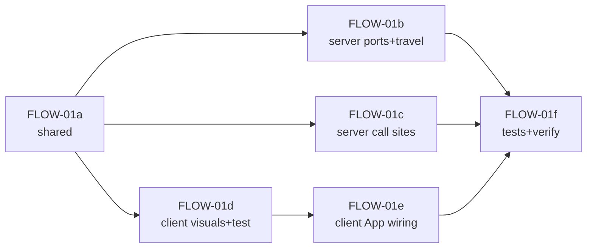

# Phase 19 — Bảng "lệnh bị từ chối" có phân loại (`FLOW-01`)

**Mục tiêu:** mọi lệnh bị server từ chối đều mang theo một mã nhóm (`RejectCode`) bắt buộc,
để client đổi màu + icon theo nhóm, giữ 3.5 s, **không** âm thanh (tránh trùng `ALERT-02`).
Không thêm message mới, không đổi schema/DB.

**Vấn đề:** 54 call site `rejectCommand` (`CommandSystem.ts` 46 + `EconomySystem.ts` 8 + travel
trong `WorldRoom.ts`) đều đổ về một notification đỏ chung (`WorldRoom.ts:1225`, payload chỉ có
`message`). Người chơi không phân biệt "thiếu tài nguyên" với "ô bị chặn", "đang bận" với
"đối tượng không còn tồn tại".

> **Status: `IMPLEMENTED`** (built 2026-11-04, awaiting verify). Slice `FLOW-01` đã được duyệt; tài liệu này là toàn
> bộ nội dung của bước plan. Quyết định đã chốt: payload `{ message, code: RejectCode }` với
> `code` **bắt buộc** (phương án A); 8 nhóm `RESOURCE, PLACEMENT, PREREQUISITE, BUSY, GONE,
> INVALID, FORBIDDEN, LIMIT`; client đổi màu + icon theo nhóm, giữ 3.5 s, **không** âm thanh.
> `packages/shared/src/types/index.ts` được phép sửa cho slice này.

Phạm vi: `packages/shared` + `apps/server` + `apps/client` (+ `docs/plans`). **Không** đổi
schema `@type()`, protocol message mới, DB, asset.

---

## 1. Hiện trạng (đối chiếu code)

| Thứ đã có | Chỗ code | Ghi chú |
| --- | --- | --- |
| `rejectCommand(client, message)` | `WorldRoom.ts:1224-1227` | gửi `ERROR_NOTIFICATION` với `{ message }` |
| Port interface | `CommandSystem.ts:61`, `EconomySystem.ts:33` | chữ ký `(client, message)` |
| Client handler | `App.tsx:244-246` | `showNotification(data.message)` |
| Notification banner đỏ chung | `App.tsx:138-142`, `:760-764` | auto-dismiss 3.5 s, icon `AlertCircle` đỏ |
| 54 call site | `CommandSystem.ts` (46), `EconomySystem.ts` (8), `WorldRoom.ts` (travel 5) | message tiếng Việt/Anh khác nhau |

| Thứ còn thiếu | Hệ quả |
| --- | --- |
| Không có mã nhóm trong payload | client không thể phân biệt loại lỗi |
| `RejectCode` chưa tồn tại | không có nguồn sự thật chung server/client |
| Port signature chưa mang code | implementer phải sửa cả port + call site |
| Client không có bảng màu/icon theo nhóm | mọi lỗi cùng đỏ `AlertCircle` |

**Edge case quan trọng:** `code` là **bắt buộc**, không optional. Server không được gửi
notification mà thiếu code; client không cần fallback "không có code" cho đường server, chỉ cho
các notification tổng hợp tự sinh ở client (phiên hết hạn, mất kết nối).

---

## 2. Quyết định thiết kế

### D1 — CHỐT: `RejectCode` là enum 8 giá trị = tên nhóm

Không tách "code chi tiết" khỏi "nhóm". Mỗi nhóm là một giá trị enum, client map trực tiếp
enum → màu + icon. Lý do: STATE đã chốt 8 nhóm; thêm mã chi tiết sẽ phình protocol và test
mà không tăng giá trị UX ở slice này. Nếu sau này cần mã con, mở phase riêng.

```ts
// packages/shared/src/types/index.ts
export enum RejectCode {
  RESOURCE = 'RESOURCE',
  PLACEMENT = 'PLACEMENT',
  PREREQUISITE = 'PREREQUISITE',
  BUSY = 'BUSY',
  GONE = 'GONE',
  INVALID = 'INVALID',
  FORBIDDEN = 'FORBIDDEN',
  LIMIT = 'LIMIT',
}
```

### D2 — CHỐT: payload bắt buộc `code`

```ts
export interface ErrorNotificationPayload {
  message: string;
  code: RejectCode;
}
```

`ERROR_NOTIFICATION` không đổi tên; chỉ đổi payload. `NetworkMessage` không thêm entry mới
(DoD chung: "không tạo message mới nếu có thể tái dùng message sẵn có").

### D3 — CHỐT: `rejectCommand` nhận `code` là tham số thứ 3

```ts
rejectCommand(client: Client, message: string, code: RejectCode): void;
```

Không đổi tên hàm, không gộp message+code thành object ở boundary server (giữ call site ngắn,
dễ grep). WorldRoom implement:

```ts
rejectCommand(client, message, code) {
  client.send(NetworkMessage.ERROR_NOTIFICATION, { message, code });
}
```

### D4 — CHỐT: phân loại tại call site, không suy luận từ message

Không parse chuỗi message ở client/server. Mỗi call site truyền đúng `RejectCode` theo bảng §3.
Điều này giữ phân loại ổn định khi wording thay đổi.

### D5 — CHỐT: client giữ 3.5 s, không âm thanh

Auto-dismiss giữ 3.5 s như `showNotification` hiện tại. **Không** gọi `playUnderAttackAlert`
hay bất kỳ audio nào (tránh trùng `ALERT-02`). Banner phân loại **không** thay thế banner
"đang bị tấn công" của phase 12; hai state React riêng (`notification` vs `underAttack`).

### D6 — CHỐT: state notification trở thành object `{ message, code }`

```ts
const [notification, setNotification] = useState<{ message: string; code: RejectCode | null } | null>(null);
const showNotification = (msg: string, code: RejectCode | null = null) => {
  const next = { message: msg, code };
  setNotification(next);
  setTimeout(() => setNotification((curr) => (curr === next ? null : curr)), 3500);
};
```

So sánh theo tham chiếu object đảm bảo timeout cũ không xoá notification mới. Notification
tự sinh ở client (phiên hết hạn, mất kết nối, …) dùng `code = null` → style mặc định đỏ
`AlertCircle` (giữ nguyên hành vi hiện tại).

### D7 — CHỐT: bảng màu + icon theo nhóm (client)

| Nhóm | Màu container | Icon (lucide) |
| --- | --- | --- |
| `RESOURCE` | amber | `Coins` |
| `PLACEMENT` | red | `MapPin` |
| `PREREQUISITE` | blue | `Lock` |
| `BUSY` | slate | `Clock` |
| `GONE` | zinc | `XCircle` |
| `INVALID` | red | `AlertTriangle` |
| `FORBIDDEN` | rose | `ShieldBan` |
| `LIMIT` | orange | `Users` |
| (null / synthetic) | red | `AlertCircle` |

Style module thuần (`apps/client/src/game/alerts/rejectVisuals.ts`) trả về class strings +
`iconKey`; `App.tsx` map `iconKey` → component lucide. Module không import React/Phaser, test
được bằng vitest node env như `underAttack.ts`.

### D8 — CHỐT: không đổi thứ tự/luồng xử lý

Không thay đổi logic validate; chỉ thêm tham số `code` ở boundary. Không refactor call site
thành helper chung. Mỗi commit một task (xem §5).

---

## 3. Bảng phân loại call site → `RejectCode`

### 3.1 `CommandSystem.ts`

| Message | Code |
| --- | --- |
| `Portals cannot be built` | `FORBIDDEN` |
| `Invalid building type` | `INVALID` |
| `Insufficient resources to construct building` | `RESOURCE` |
| `Cannot build outside map bounds` | `PLACEMENT` |
| `Placement obstructed by existing structure or resource` | `PLACEMENT` |
| `Too many units in one command` | `LIMIT` |
| `Invalid move target` | `INVALID` |
| `Unit cannot be trained at this structure` | `PREREQUISITE` |
| `Population limit reached. Build more Houses!` | `LIMIT` |
| `Insufficient resources to train unit` | `RESOURCE` |
| `Nothing is being trained here` | `GONE` |
| `Unknown unit in training queue` | `INVALID` |
| `Cannot cancel a completed building` | `INVALID` |
| `Building is still under construction` | `PREREQUISITE` |
| `Building is already upgrading` | `BUSY` |
| `Unknown building type` | `INVALID` |
| `Portals cannot be upgraded` | `FORBIDDEN` |
| `Building is already at max level` | `LIMIT` |
| `Town Center upgrade requires …` | `PREREQUISITE` |
| `Insufficient resources to upgrade building` | `RESOURCE` |
| `Portals cannot be upgraded` (cancel) | `FORBIDDEN` |
| `No upgrade is in progress` | `GONE` |
| `Invalid unit type` | `INVALID` |
| `Unit type is already at max level` | `LIMIT` |
| `Another unit research is already in progress` | `BUSY` |
| `Build a Barracks before researching this unit` (also `a Stable`, `an Archery Range`, `a Town Center` — see phase 24) | `PREREQUISITE` |
| `Insufficient resources to research unit upgrade` | `RESOURCE` |
| `No matching unit research is in progress` | `GONE` |
| `Target no longer exists` | `GONE` |
| `Cannot attack your own units or buildings` | `FORBIDDEN` |
| `That structure cannot be attacked` | `FORBIDDEN` |
| `Building is already finished` | `INVALID` |
| `Only villagers can build` | `PREREQUISITE` |
| `Unknown unit stance` | `INVALID` |

(Tất cả `Too many units in one command` → `LIMIT`.)

### 3.2 `EconomySystem.ts`

| Message | Code |
| --- | --- |
| `Too many units in one command` | `LIMIT` |
| `Resource node no longer exists` | `GONE` |
| `Resource node is depleted` | `RESOURCE` |
| `Farm no longer exists` | `GONE` |
| `That farm is not yours` | `FORBIDDEN` |
| `Farm is still under construction` | `PREREQUISITE` |
| `That building cannot be harvested` | `INVALID` |
| `Farm is empty` | `RESOURCE` |

### 3.3 `WorldRoom.ts` (travel)

| Message | Code |
| --- | --- |
| `Cổng dịch chuyển không hợp lệ.` | `INVALID` |
| `Bạn đang chuyển bản đồ.` | `BUSY` |
| `Vui lòng đợi một chút rồi thử lại.` | `BUSY` |
| `Quá nhiều đơn vị trong một lần chuyển.` | `LIMIT` |
| `Không thể chuyển bản đồ. Vui lòng thử lại.` | `INVALID` |

---

## 4. Hợp đồng kỹ thuật

- **Shared**
  - `RejectCode` enum (§D1) và `ErrorNotificationPayload` interface (§D2) trong
    `packages/shared/src/types/index.ts`.
  - Export tự động qua `packages/shared/src/index.ts` (`export * from './types/index.js'`).
- **Server**
  - `WorldRoom.rejectCommand(client, message, code)` gửi `{ message, code }`.
  - `CommandPorts.rejectCommand` và `EconomyPorts.rejectCommand` chữ ký `(client, message, code)`.
  - Import `RejectCode` từ `@chien-quoc/shared` (hoặc relative dist type). Build shared trước.
- **Client**
  - `RejectCode` import từ `@chien-quoc/shared` (qua dist).
  - `showNotification(msg, code = null)` (§D6).
  - `onMessage(ERROR_NOTIFICATION, (data: ErrorNotificationPayload) => showNotification(data.message, data.code))`.
  - Module `apps/client/src/game/alerts/rejectVisuals.ts` export:
    - `RejectVisual { containerClass: string; iconClass: string; iconKey: string }`
    - `getRejectVisual(code: RejectCode | null): RejectVisual`
    - `REJECT_VISUALS: Record<RejectCode, RejectVisual>`
  - `App.tsx` map `iconKey` → lucide component và render class strings.
- **Không đổi:** `NetworkMessage`, schema `@type()`, DB, protocol message name.

---

## 5. Thay đổi code (files to touch)

| File | Thay đổi |
| --- | --- |
| `packages/shared/src/types/index.ts` | Thêm `RejectCode` enum + `ErrorNotificationPayload` interface |
| `apps/server/src/rooms/WorldRoom.ts` | `rejectCommand` signature + body; import `RejectCode`; travel call sites truyền code |
| `apps/server/src/rooms/CommandSystem.ts` | Port interface signature; import `RejectCode`; 46 call site thêm code theo §3.1 |
| `apps/server/src/rooms/EconomySystem.ts` | Port interface signature; import `RejectCode`; 8 call site thêm code theo §3.2 |
| `apps/client/src/game/alerts/rejectVisuals.ts` | **Mới:** module thuần mapping code → style |
| `apps/client/src/game/alerts/rejectVisuals.test.ts` | **Mới:** unit test mapping (8 nhóm + null) |
| `apps/client/src/App.tsx` | import `RejectCode`, `ErrorNotificationPayload`; state notification object; `showNotification(msg, code)`; handler truyền code; banner dùng `getRejectVisual` + icon map |
| `apps/server/src/rooms/WorldRoom.test.ts` | Cập nhật assertion `ERROR_NOTIFICATION` thêm `code` |
| `docs/plans/README.md` | Thêm row phase 19 |
| `STATE.md` | Row `FLOW-01` → `PLANNED 2026-11-04 — awaiting build` |

Không đụng schema, DB, asset, protocol message.

---

## 6. Task breakdown

Size: **S** < 2h, **M** ~ nửa ngày, **L** ≥ 1 ngày.

| Task | Size | Phụ thuộc | Nội dung |
| --- | --- | --- | --- |
| `FLOW-01a` | S | — | Shared: `RejectCode` + `ErrorNotificationPayload`; build shared |
| `FLOW-01b` | M | FLOW-01a | Server: port signature + `rejectCommand` body + travel call sites |
| `FLOW-01c` | M | FLOW-01a | Server: 46 call site CommandSystem + 8 EconomySystem thêm code theo §3 |
| `FLOW-01d` | S | FLOW-01a | Client: module `rejectVisuals` + test |
| `FLOW-01e` | M | FLOW-01d | Client: `App.tsx` state + handler + banner màu/icon |
| `FLOW-01f` | M | FLOW-01b/c | Tests: cập nhật assertion server; verify tsc/test |

Thứ tự gợi ý:



**Phạm vi phase này = 6 commit** (mỗi task một commit, message tiếng Anh).

---

## 7. Test và kiểm chứng

### 7.1 Test tự động

- `pnpm --filter @chien-quoc/shared build` sạch.
- `cd apps/server && ../../node_modules/.bin/tsc --noEmit` sạch (port signature bắt buộc sẽ fail nếu sót call site).
- `cd apps/client && ../../node_modules/.bin/tsc --noEmit` sạch.
- `pnpm --filter @chien-quoc/server test` xanh (assertion đã cập nhật `code`).
- `pnpm --filter @chien-quoc/client test` xanh (có test mới `rejectVisuals`).

### 7.2 Verify tay

- Boot server + client, thực hiện các lệnh bị từ chối:
  - Đặt nhà không đủ tài nguyên → banner amber + icon Coins, 3.5 s.
  - Đặt nhà đè lên công trình → banner red + icon MapPin.
  - Train lính khi population đầy → banner orange + icon Users.
  - Harvest node đã cạn → banner amber + icon Coins.
  - Huỷ foundation của mình → **không** banner phân loại (không reject; client tự xử lý).
- Kiểm tra không có âm thanh phát ra khi reject.
- Kiểm tra banner "Đang bị tấn công!" (phase 12) vẫn đỏ pulse riêng, không bị ghi đè.

---

## 8. Edge case

| # | Tình huống | Kỳ vọng |
| --- | --- | --- |
| 1 | Reject liên tiếp 2 lệnh khác nhóm trong 3.5 s | notification mới thay thế; timeout cũ không xoá mới (so sánh tham chiếu) |
| 2 | Reject cùng nhóm lặp lại | banner reset timer 3.5 s |
| 3 | Client cũ (chỉ đọc `message`) nhận payload mới | vẫn hiển thị message; bỏ qua `code` |
| 4 | `code` không thuộc 8 nhóm (lỗi lập trình) | `getRejectVisual` fallback style mặc định đỏ `AlertCircle` |
| 5 | Notification tự sinh client (phiên hết hạn) | `code = null` → style mặc định, không bị gắn nhóm sai |
| 6 | Room switch khi banner đang hiện | banner giữ nguyên React state (chấp nhận; không crash) |
| 7 | Reject trong lúc under-attack banner đang hiện | hai banner xếp dọc (`top-16` / `top-24`), không ghi đè nhau |
| 8 | Travel reject (portal không hợp lệ) | banner INVALID (đỏ triangle) 3.5 s |

---

## 9. Rủi ro

| Rủi ro | Giảm thiểu |
| --- | --- |
| Sót call site không truyền code | tsc fail vì param bắt buộc; grep `rejectCommand(` kiểm tra |
| Phân loại sai nhóm | bảng §3 là nguồn sự thật; review diff đối chiếu; test không bắt wording |
| Shared chưa build → tsc client/server fail | chạy `pnpm --filter @chien-quoc/shared build` trước (§7.1) |
| Assertion test cũ chỉ `{ message }` | cập nhật từng assertion; dùng object exact để bắt code thiếu |
| Đổi payload làm vỡ client handler type | `ErrorNotificationPayload` import từ shared; tsc client bắt |

---

## 10. Definition of Done

- [x] `pnpm --filter @chien-quoc/shared build` sạch
- [x] `cd apps/server && ../../node_modules/.bin/tsc --noEmit` sạch
- [x] `cd apps/client && ../../node_modules/.bin/tsc --noEmit` sạch
- [x] `pnpm --filter @chien-quoc/server test` xanh
- [x] `pnpm --filter @chien-quoc/client test` xanh (có test `rejectVisuals`)
- [x] Mọi `rejectCommand(` call site truyền `RejectCode`
- [x] Không thêm `NetworkMessage` mới; không đổi schema/`@type()`/DB
- [ ] Manual scenario §7.2 có bằng chứng (screenshot) cho ≥ 3 nhóm
- [x] Không có âm thanh khi reject
- [x] Comment trong code mới viết **tiếng Anh**, tham chiếu mã task (`FLOW-01a`…)
- [ ] Mỗi task một commit, message tiếng Anh

---

## 11. Ngoài phạm vi

- Mã lỗi chi tiết dưới cấp nhóm (sub-code).
- Âm thanh reject (không làm; `ALERT-02` owns audio).
- Thay đổi wording message hiện có.
- Gộp notification reject với under-attack banner.
- i18n message (giữ nguyên tiếng Việt/Anh hiện có).

---

## 12. Nhật ký

| Ngày | Thay đổi |
| --- | --- |
| 2026-11-04 | Tạo plan: hiện trạng, 8 quyết định, bảng phân loại §3, hợp đồng §4, task §6, test §7, DoD §10. Status `APPROVED`. |
| 2026-11-04 | Built FLOW-01: shared RejectCode + ErrorNotificationPayload; server ports/call sites; client rejectVisuals + App wiring; tests green (server 184, client 387). Status `IMPLEMENTED`. |
